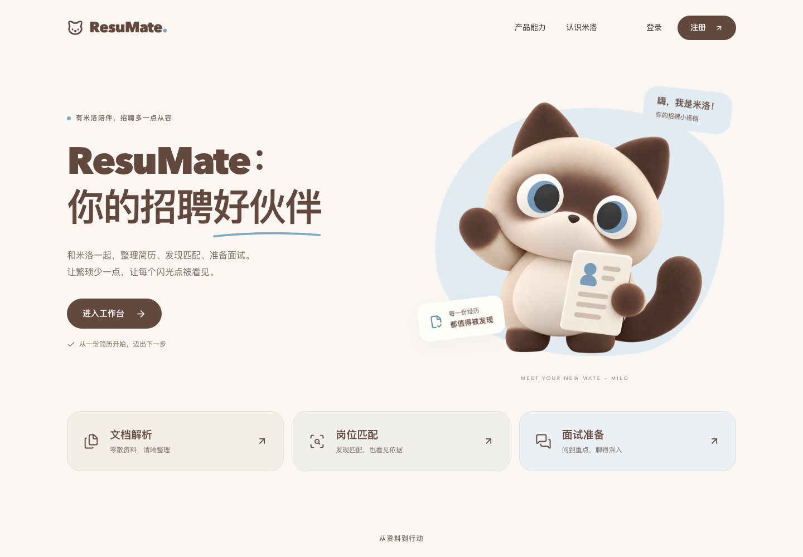
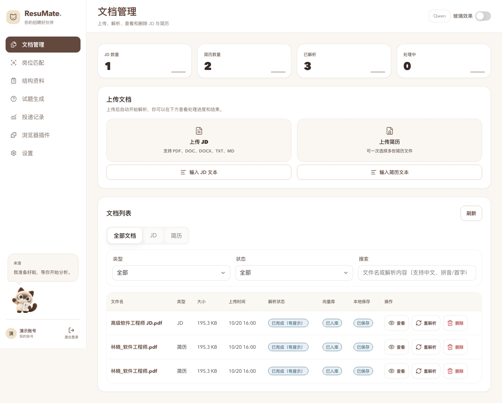
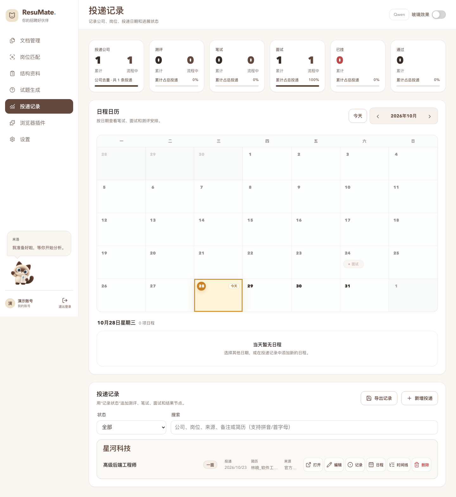
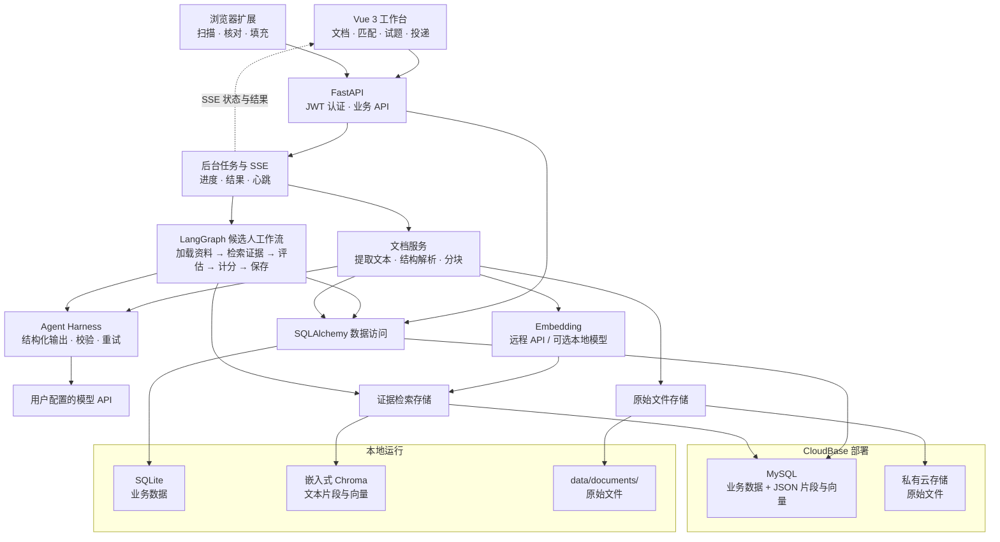

<div align="center">

# ResuMate Agent

**你的招聘好伙伴。**

和米洛一起整理简历、理解岗位匹配、准备面试，把求职与招聘中的零散信息变成下一步行动。

[界面预览](#界面预览) · [快速开始](#快速开始) · [项目架构](#项目架构) · [浏览器插件](#浏览器插件) · [云端部署](#云端部署)

</div>

ResuMate 是一个基于 **Vue 3 + FastAPI + LangGraph** 的简历与岗位分析工作台。它将文档解析、结构资料维护、基于来源证据的匹配分析、面试题生成和投递跟踪串联起来，并通过浏览器扩展辅助填写招聘表单。

本地运行使用 **SQLite + 嵌入式 Chroma**，无需额外启动数据库容器；也支持部署到 CloudBase，使用 MySQL 和私有云存储。大模型与远程 Embedding 服务由你配置。

## 界面预览

以下图片来自当前代码版本，使用虚构演示数据，不包含真实候选人资料。

### 首页 · 认识米洛

奶油色与可可棕的界面、米洛陪伴，以及通往文档解析、岗位匹配和面试准备的入口。



### 工作台 · 从文档开始

上传简历与 JD，查看解析状态、结构化结果和来源内容，再进入匹配与面试准备。



<details>
<summary>查看投递记录与日程日历</summary>

按公司和岗位管理投递，记录状态变化，并在日历中查看测评、笔试和面试安排。



</details>

## 核心能力

| 能力 | 可以做什么 |
| --- | --- |
| 文档解析 | 上传简历、岗位描述或粘贴文本，提取结构资料，保留原文与可检索片段 |
| 岗位匹配 | 按岗位标准分析候选人，查看得分、优势、差距、风险与证据引用 |
| 结构资料 | 补充联系信息、求职意向、教育、工作、项目、论文及获奖经历，逐字段复制 |
| 面试准备 | 根据岗位、候选人及匹配结果生成问题，查看考察点、回答方向、评分标准与追问 |
| 投递管理 | 管理公司和岗位、关联简历、追加状态时间线、安排日程并导出记录 |
| 浏览器填表 | 选择已保存简历，扫描招聘表单，核对匹配后仅填充勾选字段 |
| 模型与用量 | 设置个人模型、API 地址和密钥，查看调用次数、Token 消耗与近期记录 |
| 任务反馈 | 通过 SSE 展示解析、匹配和生成进度，米洛气泡同步提示处理阶段 |

## 快速开始

### 1. 准备环境

- Python **3.11 或更新版本**
- [uv](https://docs.astral.sh/uv/)：Python 依赖与环境管理
- Node.js **24** 与 npm：与项目 Docker 构建版本一致
- 可用的大模型 API；使用远程向量化时还需要 Embedding API

在仓库根目录安装依赖：

```bash
uv sync --group dev
npm --prefix frontend ci
cp .env.example .env
```

### 2. 配置模型与认证

编辑 `.env`，填写模型服务和 JWT 签名密钥。不要将示例占位值直接用于运行。

```env
JWT_SECRET_KEY=<生成的随机密钥>

OPENAI_API_KEY=<模型服务 API Key>
OPENAI_BASE_URL=<模型服务的兼容 API 地址>
LLM_MODEL=<服务支持的模型名称>

EMBEDDING_PROVIDER=qwen
EMBEDDING_MODEL=<服务支持的 Embedding 模型名称>
EMBEDDING_API_KEY=<Embedding API Key>
EMBEDDING_BASE_URL=<Embedding 服务的兼容 API 地址>
```

用下面的命令生成 `JWT_SECRET_KEY`，将输出复制到 `.env`：

```bash
openssl rand -hex 32
```

Embedding 的模型和地址需要与服务匹配。`.env.example` 提供了 Qwen 配置示例；也可选择 `openai` 或下文的 `local`。未单独填写 `EMBEDDING_API_KEY` / `EMBEDDING_BASE_URL` 时，远程向量化会回退到对应的 `OPENAI_*` 配置。

登录后可以在 **设置** 页保存个人模型配置；个人配置优先于服务端默认模型配置。Embedding 仍使用服务端的 `EMBEDDING_*` 设置。

### 3. 分别启动后端与前端

终端一，启动后端：

```bash
uv run uvicorn backend.app:app --host 127.0.0.1 --port 8000 --reload
```

终端二，启动前端：

```bash
npm --prefix frontend run dev
```

| 入口 | 地址 |
| --- | --- |
| Web 应用 | [localhost:5173](http://localhost:5173) |
| 后端 API 文档 | [127.0.0.1:8000/docs](http://127.0.0.1:8000/docs) |
| 健康检查 | [127.0.0.1:8000/healthz](http://127.0.0.1:8000/healthz) |

开发服务器默认将 `/api` 和 `/auth` 代理到 `http://127.0.0.1:8000`；后端地址不同时，可通过 `VITE_API_PROXY_TARGET` 调整。

### 4. 完成第一次分析

1. 注册并登录，确认模型配置可用。
2. 在 **文档管理** 上传一份简历和一份 JD，等待解析完成。
3. 在 **结构资料** 检查、补充解析出的字段。
4. 在 **岗位匹配** 选择 JD 和候选人，查看分析结果及来源证据。
5. 在 **试题生成** 选择对应匹配结果，生成面试题。
6. 按需在 **投递记录** 维护进展，或使用浏览器插件辅助填表。

## 项目架构



**匹配分析先检索来源证据，再让模型按标准评估。** 权重计分和推荐阈值由 Python 代码计算，报告、问题和业务记录写入数据库；向量存储负责片段检索。图中的本地与云端存储是两种运行模式，不会同时双写。

| 层次 | 主要技术与职责 |
| --- | --- |
| 前端 | Vue 3、TypeScript、Vite、Pinia、Vue Router、Lucide |
| API 与认证 | FastAPI、JWT、SQLAlchemy |
| 工作流与模型 | LangGraph、Agent Harness、结构化模型调用 |
| 文档处理 | PyMuPDF、python-docx，可选 OCR |
| 本地持久化 | SQLite、Chroma、本地文件 |
| 云端持久化 | MySQL、CloudBase 私有云存储 |
| 扩展 | Manifest V3、浏览器侧栏、页面字段识别与填充 |

### 目录结构

```text
frontend/src/           页面、组件、状态管理与 API 调用
backend/
├── routes/            HTTP 与 SSE 接口
├── services/          文档、分析、模型配置和后台任务
├── agents/            Agent Harness
├── graph/             LangGraph 候选人分析工作流
├── repositories/      业务数据读写
├── db/                数据模型与数据库连接
├── rag/               Chroma / MySQL 证据检索
└── vector/            Embedding 服务
extension/             浏览器扩展与本地表单示例
deploy/cloudbase/      云端部署说明、SQL 与打包脚本
docs/design/           视觉规范与设计资源
pics/                  README 界面截图
```

## 支持的文档与可选能力

后端支持 **PDF、DOCX、TXT、Markdown**。Web 上传入口会按简历和 JD 类型限制可选格式，也可以粘贴文本。旧版 `.doc` 不在默认解析支持范围，请先转换为 `.docx` 或 PDF。

<details>
<summary>启用本地 Embedding</summary>

```bash
uv sync --extra local-embeddings --group dev
```

在 `.env` 中设置：

```env
EMBEDDING_PROVIDER=local
EMBEDDING_MODEL=sentence-transformers/paraphrase-multilingual-MiniLM-L12-v2
EMBEDDING_DEVICE=cpu
```

首次运行需要下载模型权重。本地 Embedding 只替代向量化步骤，文档结构解析和匹配分析仍使用配置的模型 API。

</details>

<details>
<summary>启用 PDF OCR</summary>

```bash
uv sync --extra ocr --group dev
```

在 `.env` 中设置：

```env
PDF_OCR_ENABLED=true
```

OCR 用于补充扫描型 PDF 的文本提取。页数上限、渲染比例等参数见 [.env.example](.env.example)。

</details>

## 浏览器插件

在 Chrome 或 Edge 的扩展管理页开启开发者模式，加载仓库中的 `extension/` 目录。打开插件侧栏，配置后端地址并登录 ResuMate 账号。

**选择简历 → 扫描页面 → 核对字段 → 填充选中项 → 手动提交。**

插件支持中文和英文，仅填充勾选项，不自动提交申请；页面、简历或连接设置变化后需要重新扫描。安装步骤和本地表单示例见 [插件使用说明](extension/README.md)。

## 云端部署

仓库提供多阶段 `Dockerfile`：先构建 Vue 前端，再由 FastAPI 同时提供页面与 API。CloudBase 模式使用 MySQL 保存业务数据与检索片段，使用私有云存储保存原始文档。

具体环境变量、数据库初始化、镜像构建及发布步骤见 [CloudBase 部署指南](deploy/cloudbase/README.md)。

## 数据与运行边界

本地默认持久化位置：

```text
data/resumate.db        账号、文档、结构资料、报告、问题与投递等业务数据
data/chroma/            检索片段与向量
data/documents/         上传的原始文档
```

- 当前后台任务、SSE 进度和限流计数位于进程内，使用 **单实例、单 worker**；重启会中断进行中的任务，已持久化数据保留。
- 更换 Embedding 模型或提供方后，需要重建对应向量索引。本地模式应先备份数据，再清理 `data/chroma/` 并重新解析文档，不能混用不同模型的向量。
- `.env`、数据库、原始简历和运行日志属于本地运行数据，不应提交到 Git。

## 开发与验证

后端测试：

```bash
uv run pytest backend/tests -q
```

前端类型与业务测试、生产构建：

```bash
npm --prefix frontend test
npm --prefix frontend run build
```

扩展测试：

```bash
node --test extension/tests/*.test.mjs
```

界面规范与品牌资源见 [ResuMate · Milo 视觉语言](docs/design/visual-language.md)。
