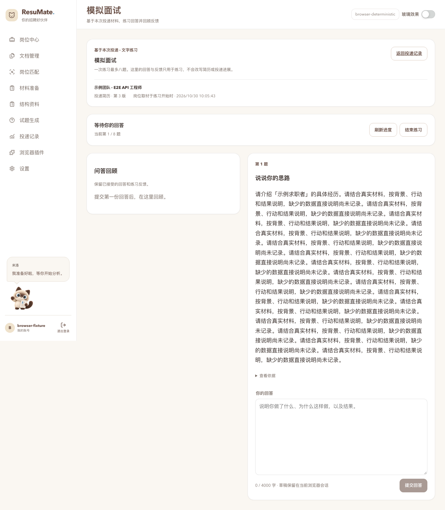

# ResuMate AI · 全栈与 Agent 教学项目

ResuMate 把收藏岗位、整理简历、补问信息、审阅来源、导出投递和文字面试放在同一个工作台。界面沿用奶油色、可可棕与米洛形象；每个开发单元同时保存设计理由、失败测试、修复记录和学习笔记。

**当前范围：** T01–T19的实现与本地确定性验收已收尾；T05/T13/T17/T19中的真实模型smoke、语义质量、分段耗时与重复评测仍未闭环。T20后续验收、T21实时双向面试和教学录屏已按用户要求取消，T20已有基础代码与历史证据保留；保留HTTP文字面试、开发教学文档与真实页面截图。真实模型质量门禁尚未通过，不将合成模型测试写成真实模型成功率。最新数字以[开发计划](docs/superpowers/plans/2026-10-29-ai-fullstack-agent-development.md)和[测试记录](docs/learning/README.md)为准。

[学习目录](docs/learning/README.md) · [整体架构](docs/architecture.md) · [开发命令](docs/development.md) · [扩展使用](extension/README.md) · [评测说明](evals/README.md) · [部署恢复](docs/deployment.md) · [性能报告](docs/performance.md)

## 聊天 Agent 工作台

默认工作入口现为 `/chat`：基于现有 Deep Agents，参考 LibreChat 的会话列表、流式回复和工具结果卡片，通过对话调用文档解析、匹配打分、简历草稿、面试问答与投递管理。保留原有专业页面作为审阅与详情入口。会话、消息、任务进度可刷新恢复；耗时任务继续由原有 worker 处理。使用方式、架构与验证范围见[聊天 Agent 说明](docs/chat-agent.md)。

## 已实现的业务流程

| 用户操作 | 保存与恢复方式 |
|---|---|
| 收藏岗位、选择主简历 | 保存岗位原文与来源；每个资源校验账号归属 |
| 准备投递材料 | 持久Run、补问动作、回答与有序事件；刷新、断网后找回进度 |
| 审阅修改 | 核对before/after、来源引用与未确认信息，逐项决定后确认版本 |
| 导出并投递 | 真实中文PDF；投递关联确认时的不可变正文快照 |
| 文字模拟面试 | 冻结本次投递材料，回答与命令去重，最多八轮；反馈可明确确认为练习记忆 |
| 原有文档/匹配/出题 | 独立worker处理，进度与结果进入同一持久任务体系 |
| 浏览器辅助填表 | 核对版本、来源和勾选字段，支持收藏当前岗位；不自动提交招聘表单 |

以下为T16真实浏览器截图，使用合成资料。后续生产页面验收保存在各单元测试记录中。



## 推荐运行方式：同机 Compose

需要Docker、可用的模型服务与Embedding配置。部署使用MySQL、两个API、Redis、一个worker、调度器和生产前端代理；不是只启动一个API就能完成长任务。

1. 按`.env.example`准备`.env`；已有文件不要覆盖。
2. 设置独立随机`JWT_SECRET_KEY`、`MYSQL_PASSWORD`和`MYSQL_ROOT_PASSWORD`。MySQL密码会进入内部连接URL，建议使用随机十六进制值。
3. 配置`EMBEDDING_API_KEY`、`EMBEDDING_BASE_URL`及匹配的模型。登录后的个人模型设置单独保存API Key、Base URL、模型、上下文容量和超时。
4. 在仓库根目录启动：

```sh
docker compose --env-file .env -f deploy/compose.yaml up -d --build
```

生产前端默认入口为`http://127.0.0.1:8787`，可通过`RESUMATE_WEB_PORT`调整。数据库和Redis只在Compose网络内，API的本机调试端口可配置。账号、资料和checkpoint存于独立持久卷，不会自动读取另一个开发目录的数据。停止时保留卷；不要对真实资料执行`down -v`。

该发布配置已完成fresh构建、依赖就绪和独立备份恢复；后续HTTP客户端与前端状态修复的镜像及回归结果在T19记录中单独保存。没有在本轮自动公网发布，也没有宣称新worker部署已适配CloudBase。旧云配置保留在[CloudBase说明](deploy/cloudbase/README.md)。

## 本机开发与测试

已验证开发工具为Python 3.12和Node 24。锁文件固定依赖；可选OCR依赖只在需要扫描PDF时安装。原生API与原生worker必须使用同一业务数据库和Redis。

```sh
uv sync --locked
npm ci
npm --prefix frontend ci
uv run python -m playwright install chromium
npx playwright install chromium
```

分别启动API、worker、调度器和Vite：

```sh
uv run uvicorn backend.app:app --host 127.0.0.1 --port 8000
uv run celery -A backend.worker:app worker --pool=solo --concurrency=1 --loglevel=INFO
uv run celery -A backend.worker:app beat --loglevel=INFO --schedule=/tmp/resumate-dev-beat
npm --prefix frontend run dev
```

上述开发方式还需要可连接的Redis，`.env`默认`redis://127.0.0.1:6379/0`。macOS原生API不能与Docker里的worker共同访问同一SQLite WAL；已实测会读到旧状态。选择全部原生，或全部进入Compose/MySQL。PDF需要Chromium和Noto CJK字体；安装与证据见[第11课](docs/learning/11-pdf-and-submission-snapshots.md)。

上传文件上限10MiB，所有PDF最多100页；OCR另受`PDF_OCR_MAX_PAGES`限制，默认关闭。文档一次尝试的提取、模型及Embedding合计最多120秒，超时会终止子进程并保存失败状态。远程Embedding请求30秒；普通模型请求使用账号设置的有限超时。

## 框架与项目各自提供什么

Vue、FastAPI、SQLAlchemy、Celery、Deep Agents和LangGraph提供UI、路由、事务、队列、图执行、文件上下文与检查点。项目在这些能力上实现SQL受理和幂等、执行epoch、工具所有权、来源引用、人工确认、投递快照、断网恢复和费用受控评测。详细数据流见[架构说明](docs/architecture.md)。

Redis不是唯一事实源，checkpoint也不是业务数据库。单worker控制checkpoint写入和执行顺序；故障恢复不意味着模型只计费一次。BYOK地址面向可信操作者配置，当前形态不宣称支持陌生人任意设置模型代理的公共SaaS。

## 开发、测试与学习

```sh
uv run pytest backend/tests -q
npm --prefix frontend test
npm --prefix frontend run test:unit
npm --prefix frontend run build
node --test extension/tests/*.test.mjs
npm run test:e2e
```

浏览器用例会创建合成账号、真实API/worker、专用Redis与临时数据库。它会操作自己的测试页面、保存截图并验证结果；模型响应使用专用测试夹具。可通过`RESUMATE_E2E_FRONTEND_PORT`、`RESUMATE_E2E_API_PORT`和`RESUMATE_E2E_FIXTURE_PORT`避开正在查看的预览。普通单元测试中的集成跳过项不是已通过。

本轮绑定新的四处真实SIGKILL证据，core30/30离线通过，详见[评测报告](docs/evaluation-report.md)。当前`core`包含30案；普通stub未提供本轮四次真实崩溃证据时，只能执行26案，4案为not_run，退出码2。真实模型试运行与首批评测共用已授权3元预算，目前两次请求失败且无usage，保留2.43941760元未知费用预约并停止；这不是已结算费用。8个durable和6个interview案例的live运行器现已补齐，并通过真实SDK与模拟HTTP验证预算、实际输入、取消和SQL行为；真实供应商质量仍未验收。三次live重复与语义审阅仍未完成。

从[教学目录](docs/learning/README.md)按“问题→契约→源码→失败测试→修复→真实联调”阅读。每单元记录命令、实际通过/失败数量、截图发现、未测边界；一次定向修复通过不会被改写成首轮全量全绿。
