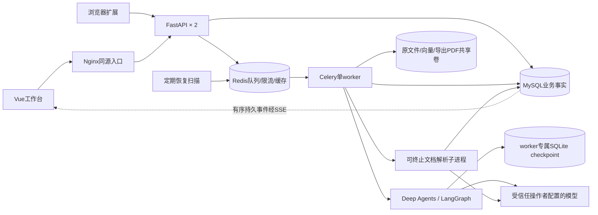

# ResuMate AI 架构与实现边界

本项目把岗位收藏、简历材料准备、人工审阅、PDF投递和文字面试串成一条可以暂停、刷新和恢复的业务流程，同时保存每个开发单元的测试与教学记录。当前为单机、双API、单worker部署。T21实时双向面试已按用户要求取消；文字面试使用HTTP命令与SQL快照。

## 服务与事实来源

**SQL决定业务是否发生。** Run受理、执行epoch、补问动作、回答、面试命令、来源事实、确认版本、投递快照和产物身份保存在业务数据库。Redis用于投递任务、原子限流、统计短缓存与通知；通知丢失不能抹去已接受的回答。checkpoint保存框架执行状态，不能代替SQL里的业务归属和确认状态。

两个API可同时读取同一SQL事实；只有一个worker持有执行锁并访问checkpoint卷。模型等待不占住业务数据库Session；写入前重新核对epoch、来源归属和会话有效性。浏览器重连按run_id/seq补查持久事件，每页100条，空轮询500ms，并在每页查询后释放Session。

## 一次材料准备如何完成

1. 前端提交requestId及简历/岗位ID；API核对账号归属，将Run持久受理后投递队列。响应丢失可使用同一requestId找回结果。
2. worker领取Run，增加attempt/epoch。图只能使用明确暴露的业务工具，读取当前来源和已确认事实。
3. 信息不足时创建补问动作并保存checkpoint。页面刷新从SQL快照和事件恢复；提交回答按动作ID、revision去重，回答和恢复意图一起保存。
4. 模型提出有来源的修改。服务端验证before值、引用和输入版本；保存草稿与ToolOperation、产物事件在同一事务中完成。
5. 用户逐条审阅，再确认简历版本。确认后的版本可生成PDF并关联投递快照；未确认的模型建议不能自动变成已投材料。
6. 文字面试冻结本次投递版本及岗位。每次回答先持久化命令，再进入一个生成Run，产生反馈及下一问题；最多八轮。用户明确确认的练习重点才成为记忆，不自动改写履历事实。

## 框架与本项目各负责什么

| 能力 | 框架提供 | 本项目实现 |
|---|---|---|
| 图执行与检查点 | LangGraph执行、恢复与SqliteSaver | Run受理、attempt/epoch、恢复扫描及单worker执行锁 |
| Agent与上下文 | Deep Agents工具调用、StateBackend文件与摘要机制 | 允许的业务工具、来源与引用校验、上下文预算、确认记忆失效 |
| HTTP与持久化 | FastAPI路由、SQLAlchemy事务 | 账号所有权、请求去重、命令确认、不可变投递快照 |
| 任务投递 | Celery与Redis | SQL受理后投递、丢投递恢复、业务幂等和重复写入阻止 |
| 交互 | Vue/Pinia/Router | 有序事件合批、草稿保留、断网恢复、来源审阅与冲突提示 |
| 评测 | 实际图和SDK被运行 | 合成案例、独立SQL oracle、同轮崩溃证据、费用预留与公开调用记录 |

## 边界与取舍

- 这是受信任操作者设置BYOK、少量账号使用的工作台，不是允许陌生用户配置任意代理地址的公共SaaS。身份与资源归属仍由服务器校验。
- 浏览器使用Bearer Token，保存在localStorage。CSP、文本渲染和外链限制降低实际入口风险；同源脚本被攻破仍可读取Token，不能把CORS当成XSS防护。
- 一个worker意味着吞吐受单槽限制。恢复保证业务写入可去重，不保证被中断的模型请求只计费一次。
- 文档尝试包含提取/OCR、结构化模型和embedding，墙钟最多120秒。专用子进程能被终止并回收；线程等待超时不等于实际工作停止。
- 原本地SQLite/Chroma及CloudBase相关代码保留。新双API+独立worker的交付以Compose/MySQL为验证环境，不据此宣称已部署到CloudBase。
- 真实模型语义质量与确定性业务正确性分别报告。stub通过不能证明模型不会编造；目前live质量门禁尚未通过。

学习顺序见[教学目录](learning/README.md)，开发范围和进度见[总计划](superpowers/plans/2026-10-29-ai-fullstack-agent-development.md)。
