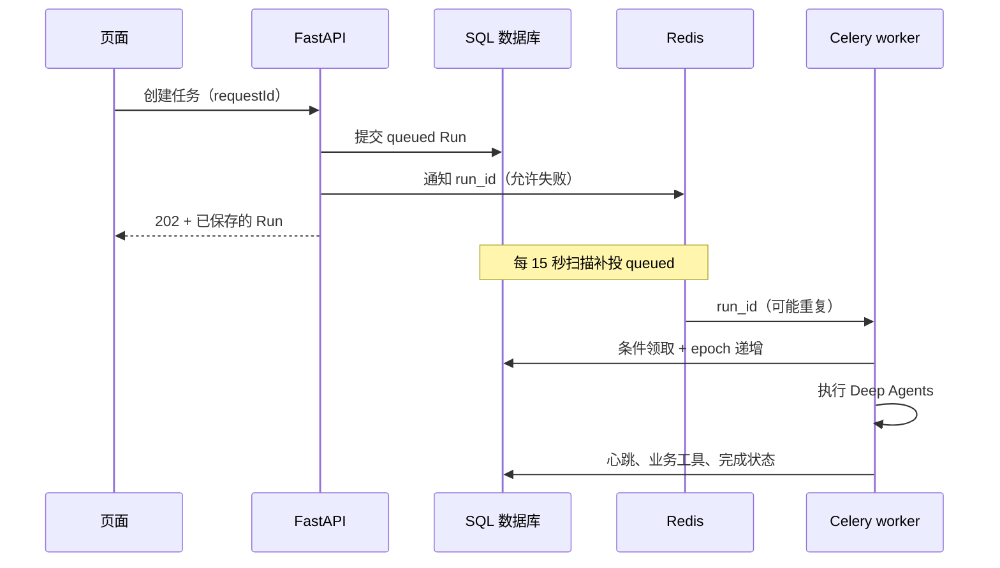

# 第四课：队列、执行权与故障恢复

日期：2026-10-29。对应 T04；业务草稿重放与 T05 联合验收。当前结果以 [T04/T05 测试记录](test-records/2026-10-29-t04-t05.md) 为准。

## 用户问题与数据流

用户提交任务后离开页面，任务仍应执行；服务重启后不能永久丢失，也不能生成两份草稿。

Redis 消息是通知，SQL 是事实源。不要把“消息发出”与“业务完成”混成同一个状态。API 先提交数据库，再通知队列；通知失败返回的仍是已持久化 Run，扫描器稍后补投。

## 代码怎么分工

- [worker.py](../../backend/worker.py)：Celery 配置，JSON 消息，晚确认，worker 丢失时允许重新投递，单执行槽，15 秒扫描调度。
- [run_delivery.py](../../backend/services/run_delivery.py)：提交后的尽力投递，只传 run_id。原生开发未配置 REDIS_URL 时，任务保留 queued。
- [worker_tasks.py](../../backend/worker_tasks.py)：独立执行入口、操作系统文件锁、10 秒心跳、扫描补投。
- [agent_runs.py](../../backend/services/agent_runs.py)：SQL 条件领取、执行代次检查、取消、恢复次数和终态。

`UPDATE ... WHERE status='queued'` 只有一个调用能成功。`execution_epoch` 随每次领取递增；工具写入必须同时满足当前 epoch、running 且未取消。检查与业务写入在同一事务里，不能先查权限、关闭事务，再另开事务写草稿。

90 秒无心跳只是“可能失联”。真正恢复前还必须拿到同一持久卷的执行锁，证明旧执行器已经退出。进程被杀后操作系统释放锁；还活着但网络慢的 worker 不能被另一个执行器并行重放。此实现明确只支持单主机、单 worker，不是多机租约协议。

自动尝试总计最多 3 次。网络连接失败、超时、429、临时 5xx 可再次排队；配置、参数错误不自动重试。用户显式重试与自动恢复分别记录，不能把无限重试包装成可靠性。

## 本次真正踩到的坑

### ORM 刷新丢掉重试次数

生产 `SessionLocal` 使用 `autoflush=False`。先 `run.attempt += 1`，再刷新 ORM 对象，会覆盖尚未提交的增量；测试若使用默认自动 flush 就漏掉了这个问题。

修复：在 `finish_run` 取得写锁、读取最新状态之后，再决定取消、重试与次数，并一次提交。测试也使用生产会话配置，断言第三次失败后不再排队。

### 心跳正常，观察者却看见旧值

实测发现 macOS 原生连接与 Docker Linux worker 通过目录挂载共同访问 SQLite WAL 时，容器已更新心跳，原生连接仍看见旧值。这是环境边界问题，不能靠放宽心跳断言或增加等待时间掩盖。

本地 Compose 因而改为 API 与 worker 都在 Docker Linux 内读写同一个持久卷；测试通过 API 和容器内查询观察结果。原生开发可继续 SQLite，但 API 和 worker 必须都原生运行。需要跨这条边界时使用 MySQL，不共享正在使用的 SQLite 文件。不要在线复制 SQLite 主文件而漏掉 WAL。

### 测试代码不在生产镜像里

仓库 `.dockerignore` 正确排除了 backend/tests。故障注入的测试 worker 最初因此无法加载。测试 Compose 覆盖文件现在只读挂载测试目录；生产镜像保持原来的排除规则。

## 如何理解故障实验

Redis `visibility_timeout=3600` 是未确认消息重新可见的时间，不是本项目恢复目标。测试在专用 Redis 中把一条测试消息的未确认时间提前，验证新消息不会立即重投、过期消息会重新出现。这不是等了一小时的墙钟实验。

worker 实验则在“草稿 SQL 已提交、工具尚未返回给图”时强制结束测试进程；90 秒失联后由 SQL 扫描恢复，重放工具应返回原版本。两条恢复机制分别验证，不混用结论。模型调用可能重复并产生费用；数据库业务结果幂等不等于模型调用恰好一次。

官方依据：[Celery Redis 说明](https://docs.celeryq.dev/en/stable/getting-started/backends-and-brokers/redis.html)、[Celery 任务确认说明](https://docs.celeryq.dev/en/stable/userguide/tasks.html)。本项目实际锁定 Celery 5.6.3。

## 学习练习

1. 画出“数据库提交成功、Redis 投递失败”的恢复路径，指出哪条记录保证任务没有丢。
2. 找到 `guard_execution`，解释为什么检查与工具写入必须共用事务。
3. 阅读三个失败回归：重复领取、取消遇超时、第三次自动失败。预测去掉哪一个条件会破坏行为，再运行对应测试验证。
4. 阅读故障日志，区分消息确认、业务事务和 checkpoint 三个独立提交点。
