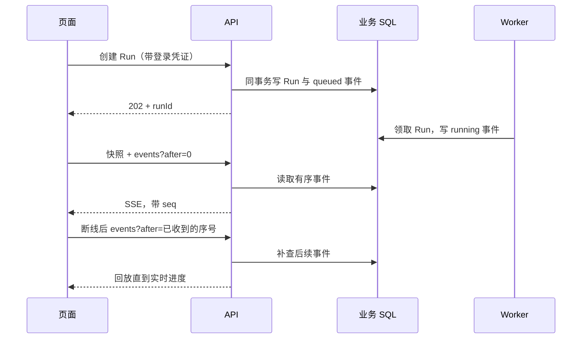

# 第六课：持久事件、鉴权 SSE 与断线恢复

日期：2026-10-29。对应 T06。配套阅读：[测试记录](test-records/2026-10-29-t06.md)、[总计划](../superpowers/plans/2026-10-29-ai-fullstack-agent-development.md)。任务工作台仍由 T07 开发，本课完成它需要的后端事件链路与前端订阅模块。

## 用户离开页面后，任务属于谁

任务属于后端业务系统。页面只是观察者：关闭连接不等于取消任务，重新进入页面也不应该重新调用模型。

这里有四份职责不同的数据：

| 数据 | 回答的问题 | 保存位置 |
| --- | --- | --- |
| AgentRun 快照 | 当前状态、待回答问题、产物是什么？ | 业务 SQL |
| AgentRunEvent | 页面离线期间发生了什么？ | 业务 SQL |
| LangGraph checkpoint | worker 应从哪个图节点继续？ | worker 专属 SQLite |
| Celery 消息 | 哪个 Run 需要被执行？ | Redis |

SQL 事件不是新的任务队列。浏览器读事件不能取得执行权，也不能代替 checkpoint 恢复 Agent。



## 为什么事件必须与业务状态一起提交

错误做法是先提交 `status=succeeded`，然后另开事务写完成事件。两步之间崩溃，页面就可能永远等不到完成通知。

[agent_runs.py](../../backend/services/agent_runs.py) 在创建、领取、等待、回答、重试、失联恢复和终态转换中调用 [append_event](../../backend/services/run_events.py)。它只刷新 SQL，不提交事务；提交权仍归业务操作。事件写失败，状态也回滚。

草稿与 `artifact.created` 同事务，补问与 `action.required` 同事务。草稿重放会返回原版本 ID，不会再发一个“创建产物”事件。工具的每次尝试可以产生新进度事件，这与业务产物去重不同。

运行中的取消先设置取消请求；此时仍是 running。worker 在执行边界响应后才写 cancelled 终态事件。不能为了让界面好看而提前声称任务已停止。

## 为什么不用“读最大序号再加一”就结束

两个写入者都可能读到 7，并准备写 8。唯一约束可以拒绝重复，却不能自动让这次写入成功。

本项目先锁住所属 Run 行，再取该 Run 的最新事件序号。所有事件都经过这个入口，因而同一 Run 的分配过程有顺序。SQLite 通过更新取得写锁；MySQL 用行锁，并对最新序号采用锁定读取。

MySQL 的细节值得单独学习：事务此前若建立了可重复读快照，普通读取可能仍看到旧的最大值。锁定读取取得当前已提交版本。测试会先开始读快照，再并发追加事件，确保这个差异没有被测试环境掩盖。

生产会话设置了 `autoflush=False`。因此入口显式刷新调用者的待写状态，避免“Python 对象已经改了，SQL 还没改”的误解；然后刷新事件，让同一事务中的下一条事件也看得到上一条。

## 一致写入以后，还要一致读取

开发时复现过这样的快照：`status=queued`，但 `lastSeq=2` 对应的其实已是 running。原因是 SQLite 的两个 SELECT 之间，worker 提交了新状态。

正常历史回放可能修正页面，但游标失效后的“从快照继续”会跳过序号 2，留下旧状态。因此 [run_snapshot](../../backend/services/agent_runs.py) 用一条 SQL 同时读取状态、待回答动作和最后序号。

[test_run_events.py](../../backend/tests/test_run_events.py) 会在读取过程中让另一事务推进任务，验证返回的状态与游标始终成对一致。这是一个真实链路问题，不是要求数据库永远不发生并发。

## SSE 的最小协议

订阅入口为 `GET /api/agent/runs/{run_id}/events?after=N`，使用 Authorization 请求头。Token 不放 URL。服务器先校验本人归属与游标，再发送流式响应；他人任务和不存在任务都返回 404。

每条业务帧形如：

```text
id: 8
event: run.event
data: {"runId":"...","seq":8,"type":"assistant.delta","createdAt":"...","payload":{"text":"请审阅草稿"}}

```

网络分片不等于事件边界。中文的一个 UTF-8 字符、一个换行符或一段 JSON 都可能被拆开。[sseParser.ts](../../frontend/src/services/sseParser.ts) 先增量解码字节，再按行解析，最后在空行处组成事件；支持 CRLF、注释、多行 data 和 id。连接中断时，尚未组成完整事件的部分不提交游标。

每 15 秒的空闲心跳是注释，不是持久业务事件。服务器每次查询最多取 100 条；回放未完成就继续取下一批。每轮查询后释放数据库连接，不让一个浏览器标签页长期占住一个 SQL 事务。当前使用短轮询查询 SQL；跨进程通知优化属于 T20。

## 前端如何恢复

[agentStream.ts](../../frontend/src/services/agentStream.ts) 的 `subscribeRun` 返回 `close()` 和 `done`，使用真实登录请求头：

1. 先取快照交给调用者，再从传入的 `after` 回放；没有游标时从 0 开始。
2. 重复序号忽略；连续的新事件交给 `onEvent`。
3. 中断按 1、2、4、8、15 秒退避重连，带上已消费的序号；重连时刷新快照的回放边界，避免把离线期间已被重试的旧失败误认为当前终态。
4. 401/403/404 等不可重试错误停止；调用者可根据错误状态引导重新登录。429 尊重 Retry-After。
5. 游标超出窗口，或检测到序号缺口，重新读取快照并触发 `onReset`，从快照游标继续。
6. 读到当前尝试的终态后停止；同一 Run 历史中旧的 failed 后面可能已有 retry，不能一遇历史失败就截断回放。

服务器也接受 Last-Event-ID 请求头，和 after 同时存在时采用较大值。当前尚未配置自动历史清理；重置协议为过期游标提供确定行为，不代表已开发事件归档系统。

关闭订阅只 abort fetch。取消业务运行必须显式调用已有 cancel 接口。T07 将把快照、补问、产物和错误展示接入页面。

## Agent 的流与用户可见事件

[runner.py](../../backend/agent_runtime/runner.py) 使用 Deep Agents 自身的 `stream`，没有另造模型—工具循环。[events.py](../../backend/agent_runtime/events.py) 只把主模型的公开文本映射为 assistant.delta，不输出 reasoning 块、工具参数或内部摘要。

文本达到 512 字符，或下一个片段到达时距上次写入超过 100ms，就合并写入；图更新和结束时也刷新余下文本。这是批量策略，不能声称每个 token 都在 100ms 内送达。最终显示延迟还受数据库轮询和网络影响。

工具事件只包含工具名、操作键、结果引用或简短错误码。`ask_applicant` 的 interrupt 是暂停，不记录成 tool.failed。实际问题保存在 AgentAction，供快照和 T07 表单读取。

`usage.updated` 累加 SDK 主模型消息中报告的用量；供应商未报告时不虚构数值。自定义 OpenAI 兼容端点需要支持流式 `include_usage`。这不是精确账单统计：内部调用、未收到用量的中断请求等可能不在此记录内，后续评测与成本观测需要单独说明范围。

checkpoint 重放可能再次输出文字或再次尝试工具；它们会获得新事件序号。seq 去重解决网络回放，业务操作键解决重复创建草稿，二者不能互相替代。

## 为什么旧页面也要修改

旧 `/api/tasks/{id}/events` 原本匿名开放。现在任务创建时绑定当前登录用户，订阅检查实际创建者，客户端改为携带请求头的 fetch。

旧页面曾先订阅、再提交任务。加上归属检查后，尚未注册的任务应返回 404，所以现在先得到 202，再通过 `onAccepted` 开始订阅，已产生的事件由旧历史回放。结果等待与界面进度仍是两个独立连接；离开页面不会中断后台业务。

新增鉴权还引出了连接生命周期问题：当前 FastAPI 会在流结束后才清理请求依赖。如果只加 `get_current_user`，用于认证的 SQL 连接可能被整个长任务占用。因此两个 SSE 接口都在完成授权后主动关闭请求数据库会话，后续新事件查询另用短会话。测试在流仍打开时检查连接池，防止仅在请求结束后检查而漏掉问题。

旧任务的归属与历史仍在 API 进程内存中，重启或切到另一进程不能恢复。这一限制与新 Run 的 SQL 持久化不同；迁移旧长任务属于 T14。现有单 API 部署适用，不能把本课记作旧任务已实现多进程恢复。

## 自己动手验证

- 在创建任务后断开 SSE，再用已收到的 seq 订阅，检查序号与内容是否完整。
- 让事件 INSERT 失败，观察任务状态是否也回滚。
- 比较同一 Run 的模型重试、网络重连、重复草稿工具调用：分别由哪个机制处理？
- 删除测试库里的一段早期历史，观察 409 重置、快照和新游标的关系。只在临时测试库练习。
- 阅读真实 Compose 故障实验：提交草稿后终止 worker，恢复后应只有一份草稿和一个 artifact.created，但允许多次工具尝试。

测试命令、结果、失败修复与验证边界统一记录在 [T06 测试记录](test-records/2026-10-29-t06.md)。
