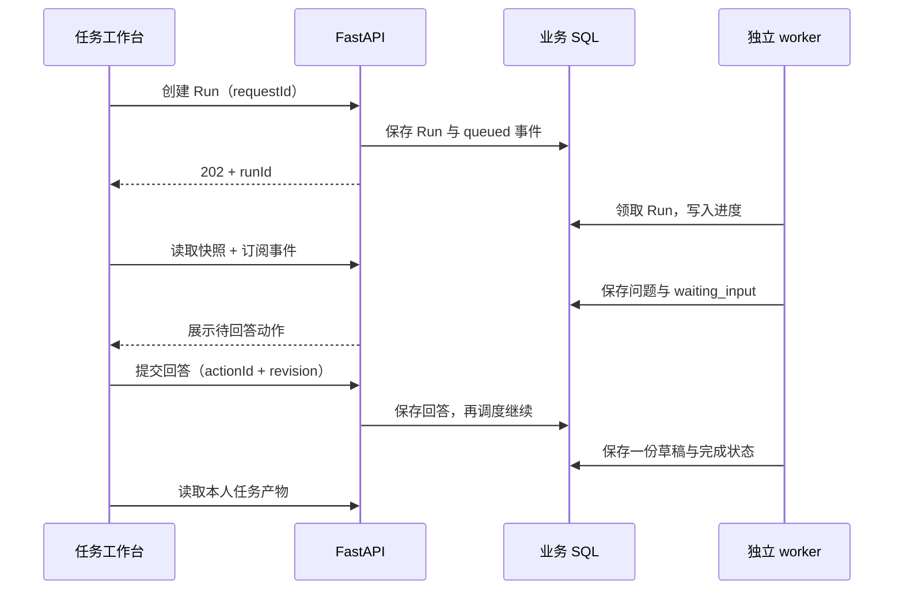

# 第七课：把可恢复 Agent 连接到真实任务工作台

本课对应 T07。先读[第六课](06-durable-events-and-sse.md)，再结合[测试与截图记录](test-records/2026-10-29-t07.md)学习。材料准备入口为 `/agent/tasks`，详情为 `/agent/tasks/:runId`。

## 用户看到的流程

用户选择已解析岗位和主简历，点击“开始准备”。API 接受任务后，独立 worker 读取资料并执行 Agent；需要补充真实经历时，页面显示问题。刷新页面还能看到同一个问题；回答成功后 worker 继续，最终产物显示为待核对草稿。关闭页面只断开事件订阅，任务仍在服务端运行。

本单元交付的是任务操作闭环。草稿内容是否有足够依据、逐条建议如何审阅、如何确认和导出，分别在 T08–T11 落实。这里的确定性模型用于验证执行流程，没有替代真实模型效果评测。

## 一、快照与事件承担不同责任

快照回答“现在是什么状态、还有什么问题”；事件回答“之前经历了什么”。进入详情页时，服务端可能已完成任务，而事件流还在回放 queued、running。若把每条历史事件直接写入当前状态，界面会倒退到“正在准备”。

`stores/agentRun.ts` 把这两类数据分开保存：`snapshot` 是当前权威状态，`events` 用于过程展示。新状态事件触发快照刷新；旧回放只追加历史。`lastSeq` 较小的迟到刷新整批丢弃，连同它当时读到的产物列表一起丢弃，避免较早的空列表覆盖刚出现的草稿。

这里有两个不同的“版本”：事件序号表示服务端业务进展；页面内的 `generation` 表示用户当前正在查看哪一次订阅。切换任务或退出登录会增加 generation，旧请求稍后返回也不能覆盖新页面。它不写数据库，也不是另一个任务版本系统。

## 二、断网、等待与失败必须有不同操作

断网只说明浏览器暂时收不到消息。Run 仍可能在运行，也可能已等待回答。页面显示重连提示，并保留现有快照；不能因此调用取消接口或把任务标为失败。

重连成功时，即使任务一直停在等待状态、没有新事件，`onConnected` 也会清除断线提示，并接受当前快照。失败状态才展示重试入口。取消必须由用户点击明确按钮发起；取消后的问题不再可提交，已输入的文字可以保留供核对。

`services/agentStream.ts` 负责网络重试与事件解析，store 负责页面状态，组件负责展示与输入。避免把服务端状态迁移逻辑复制到浏览器。

## 三、表单文字与服务端动作分开保存

问题动作由服务端持久化，未提交文字属于当前页面。两者分开后，409 冲突就不必导致输入消失。

实际双标签页情形：两个页面都看到同一个问题；A 先成功回答，B 提交旧动作时得到 409。B 刷新权威状态，同时保留自己的文字并提示“任务状态已变化”。动作已经结束时，旧输入以只读方式展示，避免误以为还能覆盖 A 的回答。

创建任务也有类似的网络不确定性：请求可能已在服务器成功，浏览器却没收到响应。同一组选项的重试复用 `requestId`，后端据此返回原任务；只有成功收到结果后才结束本次创建意图。

## 四、可访问性是交互合同的一部分

`ActionForm.vue` 给每个问题和输入框稳定关联，错误通过 `aria-describedby` 指向具体提示。空提交后焦点回到输入框；原生按钮可用键盘 Enter 提交。回答结束后焦点回到任务状态标题，让键盘用户知道页面发生了什么。

状态播报使用 600ms 节流的 `aria-live`，不把每个 token 都念出来。视觉聚焦轮廓保留，它不是需要消除的边框异常。已取消任务不能继续展示可提交按钮，也不能让步骤一直显示“处理中”。

## 五、真实浏览器联调怎样保持可重复

`tests/e2e/support/server.py` 管理整套测试资源：临时业务 SQL、独立 checkpoint、合成用户及资料、真实 FastAPI、独立 Celery worker、测试 Redis 容器与前端开发服务。测试入口负责启动和清理。

API 和 worker 都在宿主机运行，SQLite WAL 在同一操作系统中访问；Redis 容器只承担队列。与 T04 的经验一致，不能让原生 macOS 进程与 Docker Linux 同时打开同一个 SQLite WAL 文件。

确定性模型只在 `backend/tests/e2e_worker_fixture.py` 的 worker 入口替换。任务创建、鉴权、SQL、工具、补问、队列与产物接口仍走真实生产代码。双标签页测试只控制请求送达顺序；断线测试只阻断事件网络，不伪造业务响应。

这能证明系统连接正确、刷新恢复有效、取消边界正确。它不能证明真实模型会提出高质量问题，因此真实模型 smoke 与语义评测分别记录。

## 六、截图必须被人实际查看

本次沿用现有岗位匹配页的暖色背景、白色卡片、棕色按钮、文字层级和间距。桌面 1440px、手机 390px 分别运行真实页面，保存长材料、等待补问、输入错误及断线状态。

第一次图片暴露了两类问题：截图时移动侧栏尚在过渡、页面停在自动聚焦后的滚动位置；真实产品中详情子路径的导航未高亮、部分产物字段显示原始英文名、完成后的提示仍说“将继续处理”。前一类通过等待布局稳定、正常关闭侧栏并回到页首重拍；后一类修改实际组件，再重新验证。

生成 PNG 文件只是留证，不能据此宣布视觉正确。要打开图像，核对卡片边缘、控件宽度、长文本换行、导航遮挡与焦点。后续所有前端单元继续这个流程。

## 源码阅读顺序

1. `frontend/src/api/agentRuns.ts`：本人任务列表、快照、回答、产物请求与错误类型。
2. `frontend/src/stores/agentRun.ts`：状态、输入、重连和迟到响应的边界。
3. `frontend/src/views/AgentTaskView.vue`：用户完整操作路径。
4. `frontend/src/components/agent/`：时间线、工具状态、补问表单、只读草稿。
5. `backend/routes/agent_runs.py` 与 `backend/services/agent_runs.py`：列表分页、归属检查、直接读取实际产物。
6. `tests/e2e/agent-run.spec.ts`：从用户操作到真实服务端结果的验收。

## 自己动手

打开两个标签页进入同一个等待补问任务，在两个页面输入不同文字。先在一个页面提交，再观察另一页如何保留旧输入。然后用浏览器离线模式中断事件连接，区分连接提示与 Run 状态。

阅读“反序完成刷新”单元测试，说明为什么只保护 snapshot 还不够：同一旧请求返回的空产物也可能覆盖新产物。这个问题同样会出现在搜索结果、分页详情和自动保存界面中。
