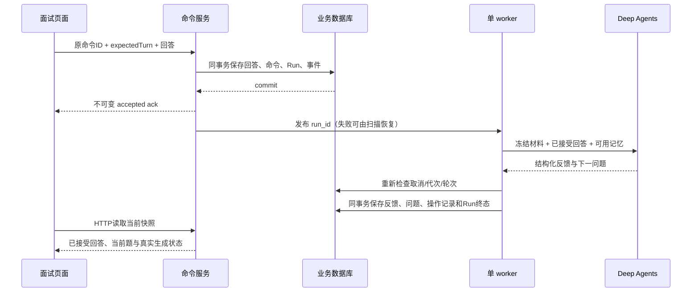

# 第十六课：把一次对话做成可恢复的业务流程

状态：实现与确定性验收完成。基于 T20 `19e1e35` 完成持久文字面试、双库事务、真实图、六案评测和实际截图；受控模型结果不能替代真实模型质量评测。

## 先冻结材料，再生成问题

这次练习使用投递记录已经固定的简历版本，并在开始时保存当时的岗位内容。两份材料的时间含义不同：简历是投递时材料，岗位是练习开始时采集。以后修改原数据不应悄悄改变正在进行的练习。

一份练习最多八题。数据库保存题目、已经接受的回答和反馈；模型只提出结构化的下一步，由业务服务校验引用和轮次后落库。练习中的回答不能自动成为简历事实。

## 收到请求和生成完成是两个时刻

回答提交后，API 返回的 ack 只表示数据库已接受。它不表示模型已经回答，也不应在生成完成后改变内容。命令 ID、原始正文、接受结果一起保存，响应丢失时客户端可以重发同一个命令，服务端返回原 ack。

前端因此分别保存“可编辑草稿”和“冻结的待重发命令”。重新编辑草稿不能修改已经发送的正文。超时只是结果未知；明确的业务拒绝才允许用户修改后重新提交。刷新页面从 SQL 读取进度，不自动创建新的回答。开始练习也需要保留尚未确认的 requestId：测试发现只保存在内存，刷新投递页后就会换一个 ID、可能创建第二次练习；改为保存在当前浏览器会话，成功后再清除。

实现中发现 Vue 的 ref 会把对象变成响应式代理，直接 structuredClone 会抛 DataCloneError，导致按钮点击后请求没有发出。测试先复现，再从 toRaw 取得原对象后复制，重发测试通过。这说明组件测试应检查实际请求正文与次数，而不只检查按钮是否存在。

## 当前页面如何避免混淆

页面沿用现有奶油底色、可可棕按钮、圆角卡片和系统字体。桌面左侧回顾、右侧当前问题，窄屏先展示当前问题，再展示历史。状态来自服务端，取消处理中显示“正在停止”；只有生成已经终止才能重试。

账号切换会清理草稿和待重发操作，并让旧请求的响应失效。手动刷新与自动读取也可能重叠，因此只接收最新一次读取的响应，防止旧轮次盖回新轮次。读取失败和业务拒绝分别保存，自动刷新成功不会让重要拒绝提示立刻消失。

保存练习记忆必须先展示确切的 practiceFocus，再由用户点击确认。它是后续练习可用的建议，不会写入 ProfileFact。

事务、真实图、记忆撤回与截图结果分阶段记录。每个阶段的原始记录见 [T16 测试记录](test-records/2026-10-30-t16.md)。

## 实际截图带来的两次修正

组件测试负责确认行为，浏览器截图负责确认用户实际看到的结果。第一轮四条真实浏览器流程全部通过，但打开 390px 截图后，页头介绍和返回按钮之间出现了数百像素空白：桌面使用 `flex: 1 1 24rem`，手机的通用样式把 `flex-direction` 改为 `column`，此时 `flex-basis` 控制的是高度。局部断点改为 `flex-basis: auto` 后，页头重新按内容排布。这里不需要重写全站布局，也没有为颜色和间距添加脆弱的像素断言。

第二个问题来自删除记忆的截图。顶部已经说明练习失效，下方却仍显示“正在整理反馈与下一题”，因为在飞行的模型调用仍处于 running/cancel_requested。生成进程尚未结束，不代表业务仍允许继续生成。页面改为优先显示 sessionInvalidated；测试先复现提示矛盾，再验证已接受回答保留、重试不可用、下一题承诺消失。

[修复前的手机页头](test-records/screens/t16/before-mobile-heading-gap.png)、[修复后的失败状态](test-records/screens/t16/interview-failed-390.png)和[320px 长内容](test-records/screens/t16/interview-long-320.png)保留在仓库。截图覆盖 1440px 桌面、390px/320px 手机、长问题与引用、准备生成、停止中、失败、结束、记忆确认/失效以及不存在的会话；根代理逐张打开查看，确认没有横向溢出、控件重叠或按钮越界，米棕色和圆角沿用已有视觉语言。

## 浏览器测试怎样验证“真实联调”

本轮启动独立 API、Celery worker、Redis 和 SQLite，浏览器执行真实登录、生成并确认简历版本、关联投递、开始面试和提交命令。仅模型 provider 由受控模型替代，真实 Deep Agents 图、工具上下文、worker 派发、SQL 事务和接口均正常执行。因此这能验证链路与状态一致性，不能证明真实模型会给出高质量反馈。

丢失响应的测试先让真实 POST 在服务端提交，再丢弃返回给浏览器的响应；刷新后发送原 clientMessageId 和原文本。除观察页面外，还读取数据库：仅一个接受回答的命令、一条回答，避免界面看起来正常而数据库重复写入。保存记忆先展示待保存内容，确认前数据库没有新增记忆；删除后当前图会话失效。

用户查看的稳定预览使用 4173/4174，自动化测试另用 4273/4274。测试端口通过测试配置传入，产品接口无需增加开关；测试结束后清理自身数据库、进程与 Redis，不打断用户正在看的预览。

## 一次回答怎样跨过 API、队列和 Agent

API 返回成功后，worker 可能尚未执行。模型调用也不能放在数据库写事务里，否则等待模型时会一直占用锁和连接。实现因此分成“接受命令”和“提交生成结果”两笔短事务，中间执行真实图；提交结果前重新读取取消、执行代次、当前轮和会话状态。取消或结束先提交，迟到的模型输出便不能落库。

创建 Run 和取消 Run 原有函数会自行提交，本单元抽出明确命名的 `create_run_in_transaction` / `cancel_run_in_transaction`，仅 flush，不擅自提交或回滚调用者事务。这样回答和 Run 不会出现“一个保存了、另一个失败”的半完成状态；原有外部入口仍负责自己的事务。

两种数据库共用锁顺序：记忆行 → 面试父行 → Run → AgentSession。MySQL 的可重复读快照可能早在鉴权查询时就建立，后续需要当前锁读和刷新 ORM 对象，不能以旧快照决定是否重复接受。另一个实测修复是同一秒的 Run 顺序：时间戳精度为秒时，随机UUID不能代表业务先后。当前生成改为按已接受生成命令的自增ID及result_ref查找；尚无生成命令时使用唯一的首个Run，不为此新建排序框架。

## 框架提供执行能力，业务服务决定什么可以保存

面试图仍由同一个 Deep Agents 工厂构造，使用 `response_format=InterviewStep`、现有 StateBackend 和 checkpoint。它只读业务上下文，不获得写回答、写记忆或结束会话的工具。输出包含反馈、下一问题和来源引用；服务端验证引用确实来自冻结材料或已接受回答，再绑定版本号、岗位采集时间和回答行ID。引用存在只证明可追溯，不能自动证明评价语义正确。

最多八题的限制由SQL轮次和输出校验共同执行：回答第八题后只允许反馈，不能产生第九题。同一个Run崩溃恢复读取同一checkpoint；如果图已完成但业务提交前中断，恢复使用已保存的结构化输出，不再调用模型。下一轮属于新的Run，清理上一轮的临时消息、文件、待办和摘要，再装入当前SQL输入。这里不自己实现另一套Agent循环。

大的冻结材料通过现有StateBackend文件分页读取。测试模型也必须遵循SDK真实读文件格式：分页范围头和截断提示不是源正文，不能算进下次offset。受控模型夹具曾因此在长材料/第七轮失败，修正解析后用真实分页重新验证；不能为了让评测变绿而绕过图或直接调用写入函数。

## 可撤回记忆与来源事实的区别

练习反馈的 practiceFocus 只有明确确认后才成为业务记忆，并绑定 `{kind: 'interview_turn', interviewId, turnId}`。重复确认返回同一活动记忆；删除后不能重新点确认把它偷偷复活。Run记录本次允许使用的记忆ID，实际每次模型调用、框架摘要和摘要重试前都会重新检查删除状态。被撤回的内容使旧图会话失效并清理checkpoint，不能从旧checkpoint继续使用它。

这些内容不会加入ProfileFact。用户在模拟回答中提到的新经历仍是练习输入，不能直接进入真实简历。真实模型质量评测仍需另行通过；本轮六案采用受控模型，只验证真实服务、图执行与独立结果核对。

2026-10-30按用户要求取消T21。当前课程与产品使用HTTP命令和快照恢复，不再计划WebSocket双向连接、question.delta或相关四个新评测；最终数据集保持30案。

## 异步响应不一定属于当前页面或当前对象

独立审查又补了两种用户可以实际遇到的交错。开始面试后离开投递页，迟到响应不应强制把用户导航回来；组件卸载后忽略旧导航，同时保留requestId，回来可读取原创建结果。确认记忆时刷新页面数据，会替换内存中的turn对象；成功后应按行ID更新当前快照，而不是修改已经脱离页面的旧对象。保存成功还要使较早的GET失效，避免旧快照把已保存标记覆盖回去。三条测试先失败再修复，原来的12条行为断言保持通过。
