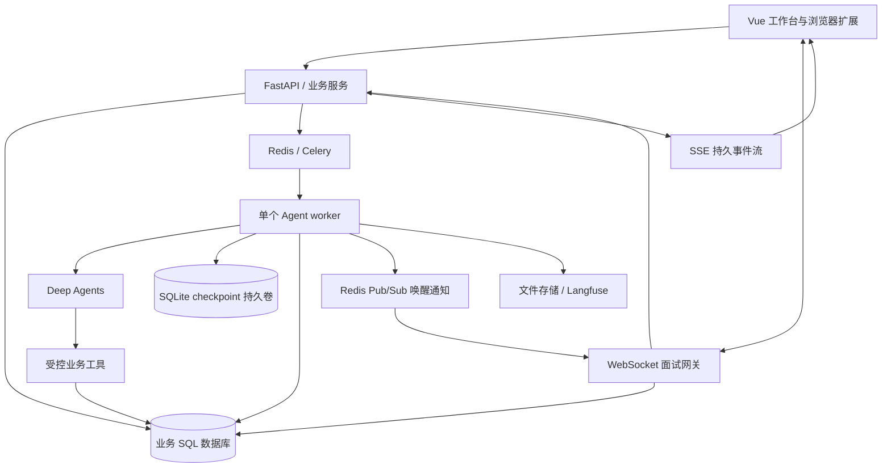

# ResuMate AI 全栈与 Agent 开发计划

> **For agentic workers:** REQUIRED SUB-SKILL: Use superpowers:executing-plans to implement this plan task-by-task. Steps use checkbox (`- [ ]`) syntax for tracking. 每个任务独立交付与验证；边界独立的实现可并行，整合后统一测试与审查。

**Goal:** 将现有分析工作台升级为覆盖四层能力的求职 AI 全栈应用，使用 Deep Agents、应用级 Harness 和评测支撑可恢复的真实业务任务。

**Architecture:** Vue 工作台和浏览器扩展通过 FastAPI 调用业务服务。业务数据库保存权威数据、Run 和事件；Celery/Redis 驱动独立 worker；Deep Agents 执行决策和工具调用，LangGraph checkpoint 保存执行状态。业务写入与图状态分别管理，以业务幂等保证重复执行不会重复产生结果。

**Tech Stack:** Vue 3、TypeScript、Pinia、Vite、FastAPI、Pydantic、SQLAlchemy、MySQL/本地 SQLite、Celery、Redis（redis-py / Lua / Pub/Sub）、WebSocket、SSE、Deep Agents、LangGraph SQLite checkpoint、Playwright、Vitest/Vue Test Utils、pytest、Langfuse、Docker Compose。

**Spec:** [已确认范围与设计边界](../specs/2026-10-29-ai-fullstack-agent-scope.md)。执行前先读该文件和仓库根目录 AGENTS.md。

## 实测驱动修订（2026-10-29）

本次依据 T01–T03 已提交成果、T04/T05 实现与故障实验调整依赖和验收，保留原有 21 个任务 ID 与产品范围。任务的基础测试、跨进程恢复、真实模型 smoke 和内容质量评测分别记录，不能互相替代；原工期为初始估计，不是当前剩余工期。

| 任务 | 当前状态 | 已有证据与未完成边界 |
|---|---|---|
| T01 | 完成并提交 | 后端 220、组件 2、浏览器 1 项通过；依赖与 checkpoint 契约已验证 |
| T02 | 完成并提交 | SQLite/MySQL 数据契约与全后端 244 项通过 |
| T03 | 完成并提交 | Run API、权限、并发与动作回答；全后端 275 passed / 1 skipped |
| T04 | 基础与联合恢复验收完成 | 31 项 T04/T05 单元通过；全后端 306 passed / 2 skipped；Compose 实验单独 1 passed / 139.91s，真实心跳、SQL 扫描与 SIGKILL 后重放成功，草稿仍为一份 |
| T05 | 实现及确定性自动验收完成；真实模型 smoke 待执行 | 正常生成、补问恢复、工具失败、重复写入及审查回归通过；未调用付费模型，不能作为内容质量验收 |
| T06 | 实现与自动验收完成 | SQL 事件、鉴权 SSE、断线续接、旧流鉴权；真实 Compose 故障与游标回放 1 passed / 140.85s，详见 T06 记录 |
| T07 | 完成确定性验收 | 任务工作台、真实 API/worker 浏览器流程与桌面/手机截图通过；真实模型 smoke 仍待 M1 演示前补齐 |
| T08 | 完成确定性验收 | 岗位、事实版本与来源撤回；后端 442、前端 63、真实浏览器 11 项通过，7 张截图已实际查看 |
| T09 | 完成确定性验收 | 固定输入、逐字段建议与三类来源；508 后端、67 前端通过，旧资料真实浏览器场景及桌面/手机图已查看；语义评测仍待执行 |
| T10 | 完成确定性验收 | 552 后端、87 前端、15 浏览器通过；冲突与确认冻结、6 张实际截图验收完成 |
| T11 | 完成确定性验收 | 626 后端、94 前端、17 浏览器通过；真实 Linux PDF 1 passed，两页1218字及逐页图已查看 |
| T12 | 完成确定性验收 | 678 后端、20 浏览器通过；14 张实际截图查看；上下文/记忆与审查修复见 T12 学习记录 |
| T13–T21 | 待开发；T13 实施中 | 按下文依赖推进事实依据、审阅导出、评测、实时面试和交付，不将当前基础测试视为这些能力已完成 |

T04/T05 已修复并补回归的实测问题包括：`autoflush=False` 下刷新对象丢失 attempt 导致无限自动重试；取消遇模型超时未进入终态；同 Session 新 Run 沿用旧 files/todos/摘要。学习导航应随新测试记录更新当前状态；T01–T03 记录保留当时环境与验证边界，后续补充通过链接关联，不改写历史结论。

## Global Constraints

- 保留 Vue 3 + TypeScript + Python/FastAPI；不新增 Java 服务作为本轮主线。
- Deep Agents 是主运行时；不再自写一套通用模型—工具循环。
- RAG 不优先更换向量库，不建设复杂混合检索、知识图谱或检索平台。
- 不包含自动海投、自动发送邮件、支付、多租户组织管理、多机调度、任意代码执行平台。
- 本计划只规划开发，不授权自动上线、外部投递或发送消息。
- 保留用户已有数据和未提交修改；不要借机进行全仓重构。
- 所有新文件路径为计划路径；实现前按最新代码确认引用，不能当成已经存在。
- 每个检查先说明它检测的具体失败，以及失败后会如何修改。不要反复运行已通过且未受新变更影响的检查。
- 用户补充要求：每个前端单元必须运行真实页面、保存并逐张查看截图，检查桌面/手机布局、长内容、空/错等边界状态的对齐、溢出和遮挡；修复后复查受影响截图。保持既有视觉语言，编译或 DOM 测试不能替代截图验收。
- Python 项目当前要求 >=3.11，Docker 使用 3.12；Node 当前使用 24。依赖采用任务 T01 实测兼容的稳定版本并提交锁文件，不在文档中虚构版本组合。
- 数据库使用普通主键、来源 ID 和唯一约束解决重复操作，不新增内容指纹系统。
- 用户自用/少量受邀账户为首版范围；涉及实际鉴权、上传、外部内容和工具写入的安全属于必做项。

## 1. 现状与复用范围

阅读依据：README、backend/db/models.py、backend/db/database.py、backend/graph/candidate_workflow.py、backend/agents/harness.py、backend/agent/agent.py、backend/agent/interview_tools.py、backend/services/background_tasks.py、backend/services/progress.py、backend/routes/tasks.py、frontend/src/services/sse.ts、frontend/src/router/index.ts、Dockerfile。

| 现有部分 | 处理方式 |
|---|---|
| Vue 工作台、资料、投递、日程、视觉设计 | 复用页面与风格，补业务状态和交互，不重新做品牌 |
| 文档解析、结构资料、证据检索 | 保留；增加事实版本引用，不重建 RAG |
| CandidateAnalysisGraph | 保留确定性匹配流程，作为 Agent 可调用的业务能力 |
| AgentHarness.run_schema | 保留结构化模型调用能力；不要把它当作新运行系统 |
| 旧聊天 Agent 与 interview_tools | 将重复业务实现收敛到业务服务，接入新运行时后移除实际无调用的旧路径 |
| BackgroundTasks + 内存 progress_hub | 长任务逐项迁入 worker，事件持久化后替换内存事件源 |
| /api/tasks/{id}/events | 当前无鉴权；明确补齐用户归属与授权，属于实际缺口 |
| 前端 EventSource | 当前错误即关闭，不能满足断线续接；改为可携带认证头的 fetch 流读取 |
| SQLite/MySQL、CloudBase 存储 | 保留已有支持；新 Compose 部署单独说明，不承诺未验证的云运行方式 |
| 现有测试 | 保留有行为价值的测试；新增组件/E2E 测试，不为文件字符串形状扩大测试 |

## 2. 首版成果与非目标

### 必须完成的用户流程

1. 用户收藏或粘贴岗位，关联主简历和已确认经历。
2. 查看有来源的匹配意见，启动材料准备任务。
3. Agent 发现关键经历信息不足，提交补问，任务进入等待状态。
4. 用户稍后返回并补充；原任务继续，不丢失前序结果。
5. 用户查看逐项修改理由和来源，选择接受或编辑，生成独立简历版本。
6. 导出 PDF，并将岗位、简历版本和投递记录关联。
7. 围绕此次提交材料开展多轮文字模拟面试，保存反馈。
8. 在任务中心查看阶段、工具执行、失败原因、产物与用量。

### 暂不投入

批量自动海投、多渠道邮件同步、语音面试、微服务拆分、Kubernetes、多模型自动竞价路由、自研通用 Harness、复杂向量检索、完整在线简历排版器。

## 3. 架构与明确的技术决策



### 运行职责

- FastAPI：认证、参数与归属校验、业务 CRUD、Run 接受、补问提交、事件读取。禁止在请求处理中长时间调用模型。
- Celery：传递 run_id 和控制操作；模型密钥、简历全文不放消息体。生产演示从一个 worker、一个执行槽开始，清楚展示排队，不伪称高并发 Agent。
- Deep Agents：计划、工具调用、补问和上下文管理。显式禁用不需要的通用 shell 能力；文件工作区仅在本任务资源范围内。
- SQL：业务事实、Run 状态、待处理动作和事件均在数据库；Redis 丢失不能使已接受任务永久消失。
- checkpoint：worker 专属 SQLite 文件；API 不直接操作图 checkpoint。并发扩展需要后续专门切换共享 saver，不在本计划实现。
- Compose 分阶段落地：T04/T05 初始环境为 Redis、worker、调度器与 SQLite 业务库，API 在宿主机；实测发现 Docker 内 heartbeat 已更新而宿主机连接仍读到旧值，macOS Docker 虚拟机与宿主进程共享 SQLite WAL 不保证一致。已调整为 API、worker、调度器和 Redis 均在 Docker 内，所有业务 SQLite 读写在 Linux 容器侧通过共享持久卷完成；测试使用真实 API 和容器内读库观测。此项修正与 SIGKILL 重试已通过，日志见 T04/T05 测试记录。原生开发则 API/worker 都原生运行，不支持一半宿主、一半容器共享 SQLite 的运行方式。
- MySQL 9.6 行为测试单独记录，不能据此宣称 Compose MySQL 全链路或 MySQL 8.x 已验证。T20 跨进程测试前补齐共享 MySQL 与两个 API 进程，T17/T21 复用该环境；T19 完成发布配置、备份恢复与完整回归。最终单机集成范围保持 MySQL、Redis 和一个 Agent worker。
- 文件产物：开发时使用受控数据目录，已有云存储路径继续复用；通过应用校验归属后下载。
- Langfuse：观测与评测，不成为任务能否执行的依赖。首版可接托管实例；未配置时业务仍可运行。

### HTTP、SSE、WebSocket 与 Redis 分工（AI-Meeting 调研后修订）

- HTTP：业务 CRUD、创建任务、历史快照、下载、申请 WebSocket 临时票据。
- SSE：解析、简历生成等单向长任务进度，沿用持久事件游标协议。
- WebSocket：模拟面试中的回答提交、停止当前回答生成、会话结束、实时反馈。首版文字双向交互；语音、ASR/TTS 仍是后续范围。
- Redis：Celery broker、跨 API 进程限流、一次性 WS 票据、面试事件唤醒、短期面板统计缓存。使用 redis-py 异步客户端和有限的 Lua 原子操作，不引入 Java Redisson。
- SQL：回答、面试事件、Run、业务操作去重与产物的权威源。Redis Pub/Sub 是至多一次通知，不能用于保证持久消息送达。
- 发布顺序为 SQL 事务提交 → Pub/Sub 提示 {interviewId,lastSeq}。网关从数据库读取实际事件；通知丢失时每 2 秒对活动连接补查，重连按 seq 补发，避免提交后发布失败造成永久漏消息。
- 不新增 Redis Streams 消费组或 MongoDB：任务已有 Celery，历史已有 SQL/checkpoint，不建设第二套队列和状态源。
- 保留现有 SQL requestId、ToolOperation、execution_epoch 机制；不另写分布式 single-flight 框架。重复请求共享同一 Run，不能据此承诺崩溃后的 LLM 调用恰好一次。

### 网络与任务一致性

- Run 创建先提交数据库，再发布队列消息。发布失败仍返回已持久化 Run 的排队状态，调度扫描每 15 秒重新投递未领取任务。
- 消息可重复，领取通过数据库条件更新；每个 Session 同时只允许一个活动 Run。
- worker 每 10 秒更新心跳；90 秒无心跳进入恢复判定。只有确认旧执行器不再持有运行权后才接管；写工具检查当前执行代次。首版单 worker 降低并行接管复杂度，但不得并行重放同一 Run。
- 只对网络超时、429、临时 5xx 做有限重试；参数错误、鉴权错误、用户拒绝不重试。最多 3 次自动尝试，超过后显示失败与人工重试入口。
- 对已提交外部副作用、结果不确定的操作不盲目重放。首版不包含外部投递或发信；创建草稿等数据库写入用唯一操作键与事务恢复结果。
- SSE 断开仅取消订阅，取消任务必须调用独立 API。
- 不承诺模型调用恰好一次；崩溃窗口可能重复付费，记录 attempt、用量来源和恢复说明。

## 4. 数据和接口契约

### 新增数据（复用 User、Resume、JobDescription、JobApplication）

| 对象 | 必需字段与约束 |
|---|---|
| 岗位补充字段 | JobDescription 增加 source_url、source_site、source_job_id、captured_at、status；来源 ID 存在时按 user_id/source_site/source_job_id 唯一 |
| ProfileFact | id、user_id、kind、content、source_document_id、revision、confirmed_at、deleted_at；修改新增版本或保留历史值，引用可追溯 |
| ResumeVersion | id、user_id、run_id、resume_id、jd_id、parent_version_id、revision、structured_content、fact_refs、status、created_at；确认后内容不可原地覆盖 |
| Application 关联 | 增加 jd_id、resume_version_id；旧记录为空仍可查看；保留提交版本快照 |
| AgentSession | id、user_id、purpose、active_run_id；数据库约束/条件写入保证一个活动 Run |
| AgentRun | id、user_id、session_id、request_id、kind、status、input_json、input_versions、attempt、execution_epoch、heartbeat_at、cancel_requested_at、error_code、output_refs、created_at、updated_at |
| AgentRunEvent | run_id、seq、type、payload、created_at；(run_id,seq) 唯一；seq 在 Run 行锁/事务中分配 |
| AgentAction | id、run_id、interrupt_id、kind、payload、status、response、answered_at；同一个动作只接受一次有效回答 |
| ToolOperation | run_id、operation_key、tool_name、status、result_ref；(run_id,operation_key) 唯一，与业务结果同事务提交 |
| InterviewEvent | interview_id、seq、type、payload、created_at；(interview_id,seq) 唯一；seq 由面试行锁事务分配 |
| InterviewCommand | interview_id、user_id、client_message_id、type、result_ref、status；(interview_id,client_message_id) 唯一；与回答/Run 创建同事务提交 |
| InterviewSession/Turn | application_id、resume_version_id、question、answer、feedback、turn_index；每轮记录与源版本关联 |

AgentRun 增加 (user_id, request_id) 唯一约束。AgentRun 不复用现有 AnalysisJob 的语义。checkpoint 保存序列化 ID 与状态，不放数据库 Session、ORM 实例、客户端或密钥。

### 状态与事件

```text
queued -> running -> waiting_input -> queued -> running -> succeeded
                  -> waiting_approval -> queued -> running
queued/running/waiting_input/waiting_approval -> cancelled
running -> failed
failed --显式重试同一 Run / attempt+1--> queued
```

终态为 succeeded/failed/cancelled。cancel_requested_at 是请求标记，只有执行停止或确认未执行后才记 cancelled；无法中断的在途调用结束后丢弃其未提交结果。

```ts
type RunEvent = {
  runId: string; seq: number; createdAt: string;
  type: 'run.status' | 'assistant.delta' | 'tool.started' | 'tool.completed'
      | 'tool.failed' | 'action.required' | 'artifact.created' | 'usage.updated';
  payload: Record<string, unknown>;
};
```

实现时将 payload 收敛为上述 type 对应的判别联合。assistant.delta 在 worker 内按 100ms 或 512 字符聚合，不逐 token 写数据库；最终文本单独保存。

### API

| 方法与路径 | 契约 |
|---|---|
| POST /api/jobs | 粘贴或扩展采集；返回岗位 ID；首版不接受服务端任意 URL 抓取 |
| GET /api/jobs?cursor=&limit= | limit 默认 20、最大 100；稳定按 created_at/id 排序 |
| POST /api/agent/runs | {sessionId?,kind,jdId,resumeId,requestId}；202 + {runId,status}；同用户 requestId 重复提交返回同 Run |
| GET /api/agent/runs/{id} | 快照、最后事件序号、待处理动作、产物；验证用户归属 |
| GET /api/agent/runs/{id}/events?after= | Bearer 鉴权；SSE id=seq，支持 Last-Event-ID；从游标后续传 |
| POST /api/agent/runs/{id}/actions/{actionId} | {decision,answers,expectedRevision}；重复相同回答返回原结果；冲突 409 |
| POST /api/agent/runs/{id}/cancel | 接受取消请求；重复请求无额外效果 |
| POST /api/agent/runs/{id}/retry | 仅 failed 可重试；保留输入快照，资料已变化则引导创建新 Run |
| PATCH /api/resume-versions/{id} | 草稿修改带 expectedRevision；冲突 409，不覆盖他人/另一标签页修改 |
| POST /api/resume-versions/{id}/confirm | 冻结版本；用户审阅后的业务动作 |
| POST /api/resume-versions/{id}/export | 创建导出 Run，202；产物下载仍需归属校验 |
| POST /api/interviews | 从投递或岗位与版本创建文字面试 |
| POST /api/interviews/{id}/ws-ticket | Bearer 鉴权和归属校验；返回 30 秒有效、一次性 ticket；不返回/转发长期 Token |
| WS /api/interviews/{id}/ws | 第一条消息为 auth {ticket,afterSeq}；服务端 5 秒内验证票据、会话归属与 Origin，否则关闭 |
| GET /api/interviews/{id}/events?after= | 用于历史补发/排障的鉴权分页读取，返回持久 InterviewEvent |

错误体统一为 {code,message,requestId,details?}；400/422 参数，401 登录失效，403 无权限，404 资源不存在或不属于当前用户，409 状态冲突，429 限流并带 Retry-After，503 短时不可用。

## 5. 文件与模块边界

| 路径 | 职责 |
|---|---|
| backend/agent_runtime/factory.py | 唯一 Deep Agents 构建入口；模型、工具、checkpoint、中间件 |
| backend/agent_runtime/runner.py | Run 执行、interrupt/resume、取消、恢复；不实现自定义 LLM 循环 |
| backend/agent_runtime/context.py | 输入快照、相关事实选择、预算与外置结果引用 |
| backend/agent_runtime/tools.py | 调用业务服务的工具定义与结果契约 |
| backend/agent_runtime/events.py | Deep Agents 事件到业务事件的映射与聚合 |
| backend/agent_runtime/skills/ | resume-tailoring、interview-prep 两个首版技能 |
| backend/services/agent_runs.py | 创建、领取、恢复、补问、取消的业务状态转换 |
| backend/services/jobs.py / resume_versions.py / profile_facts.py / interviews.py | 各业务域的权威读写入口 |
| backend/worker.py / backend/worker_tasks.py | Celery 初始化、任务入口与恢复扫描 |
| backend/routes/agent_runs.py / jobs.py / resume_versions.py / interviews.py | HTTP 契约与授权 |
| backend/schemas/agent_runs.py / resume_versions.py | Pydantic 请求、返回、事件定义 |
| backend/db/agent_models.py / career_models.py | 新模型；通过现有 init_db 注册，不复制 Base |
| frontend/src/views/JobsView.vue / AgentTaskView.vue / ResumeEditorView.vue / InterviewView.vue | 四个业务界面 |
| frontend/src/services/agentStream.ts | 带认证的 fetch SSE、解析、重连、取消订阅 |
| frontend/src/stores/agentRun.ts | 按 Run 管理快照、事件去重、游标与动作 |
| frontend/src/components/agent/ | 工具卡、补问表单、产物卡、运行时间线 |
| frontend/src/components/resume/ | 修改对比、来源引用、预览 |
| evals/ | 脱敏案例、运行器、确定性验证器、结果报告 |
| tests/e2e/ / tests/load/ | 完整用户流程和可重复负载 |
| deploy/compose.yaml / deploy/nginx.conf | 单机集成环境与网络配置 |

## 6. 里程碑、依赖与工作量

以下为制定计划时的初始估计，以单人有效开发日计，包含测试、集成和文档，不是承诺日期，也不是当前剩余工期。初始总计约 54–73 个开发日（约 11–15 个全职工作周）；本次不重新估算工期，后续以实际进度和验证结果调整。

| 阶段 | 任务 | 初始预计 | 可演示成果 |
|---|---|---:|---|
| M0 基线与契约 | T01–T02 | 3–4 日 | 可重复的开发环境、数据与接口契约 |
| M1 四层最小闭环 | T03–T07 | 12–16 日 | 页面发起 → worker → Deep Agents 补问 → 恢复 → 有权限的流式状态 |
| M2 申请材料闭环 | T08–T11 | 10–13 日 | 岗位 → 修改审阅 → 版本 → PDF → 投递 |
| M3 Harness 深度与评测 | T12–T14 | 8–11 日 | 上下文/记忆、可观测性、故障恢复与基准报告 |
| M4 扩展与实时面试 | T15–T16、T20–T21 | 12–16 日 | 扩展收藏、Redis 工程与 WebSocket 双向面试 |
| M5 性能、安全与交付 | T17–T19 | 9–13 日 | 有条件说明的性能报告、关键安全验证、部署与演示 |

当前主线：T01–T03 已完成 → T04 投递基础 / T05 运行工具实现 → T04/T05 联合恢复验收 → T06 → T07 → T08/T09 → T10 → T11。T07 验收的是内部功能闭环；事实依据和材料内容质量仍由 T08/T09、人工审阅及后续 live 评测验证。
后续依赖：T13 从 T05 的小数据集开始，长上下文案例依赖 T12；T14 扩展 T13 的评测并迁移现有长任务。T16 使用 T11 的提交版本与 T12 的确认记忆。T04/T06 → T20；T16/T20 → T21；T14/T21 → T17/T18 → T19。T20/T21 为追加编号，实际在 M4 执行，不在发布后补做。
安全基线从 T03/T06 开始，T18 是发布前整体验证，不是最后才加鉴权。

## 7. 逐任务实施计划

每个任务完成后形成可审查提交；存在运行依赖的 T04/T05 可联合提交，但分别记录单元验证与联合验收。只暂存本阶段修改，不自动推送。行为变更先补能表达预期的失败测试，再实现，再运行相关测试。以下测试代码为实施时应落地的契约示例，fixture 与辅助方法在指定测试文件/conftest 中一并实现。新 Vitest 用例统一使用 `src/**/*.spec.ts`；已有 Node 自执行 `*.test.ts` / `*.test.mjs` 保留原测试入口，不扩大 Vitest 收集范围。

### T01：依赖兼容与开发基线

**文件：** 修改 pyproject.toml、uv.lock、frontend/package.json、frontend/package-lock.json；新增 backend/tests/test_deepagents_contract.py、frontend/vitest.config.ts、docs/development.md。
**输入：** 当前仓库与锁文件。**输出：** 可复现安装、Deep Agents 补问/继续的最小测试。

- [x] 用稳定 Deep Agents 与官方 SQLite checkpoint 依赖建立最小图，使用可控模型替身完成一次工具调用与 interrupt/resume；确认 Python 3.12 与现有 LangChain 依赖兼容。
- [x] 只调整实际冲突的依赖并锁定；不顺带升级全部前端包。加入 Vitest/Vue Test Utils 与 Playwright 开发依赖，保留现有测试入口。
- [x] 建立 `npm --prefix frontend run test:unit` 和根目录 `npm run test:e2e` 命令；E2E 配置归于根目录新 package.json，只放测试工具。
- [x] 记录当前相关测试结果；失败区分原有与新增，不虚构“基线全部通过”。

```python
def test_agent_can_continue_after_user_input(agent_fixture):
    paused = agent_fixture.start("prepare application")
    assert paused.action.kind == "input"
    finished = agent_fixture.resume(paused.action.id, {"project_role": "backend"})
    assert finished.status == "succeeded"
```

**验证：** `uv run pytest backend/tests/test_deepagents_contract.py -q`。检测 SDK 组合无法暂停/继续；失败则修正依赖和构建方式，后续任务不得绕开此失败自写循环。

执行记录：[T01 实测与教学](../../learning/test-records/2026-10-29-t01.md)。

### T02：业务与 Run 数据契约

**文件：** 新增 backend/db/agent_models.py、backend/db/career_models.py、backend/schemas/agent_runs.py、backend/schemas/resume_versions.py、backend/tests/test_agent_models.py、backend/tests/test_resume_version_models.py；修改 backend/db/database.py、backend/db/models.py；新增 deploy/schema/001_agent_and_versions.sql。
**输入：** 第 4 节对象。**输出：** 数据表、唯一约束、状态类型；`RunStatus` 与 `RunEvent` 为后续唯一来源。

- [x] 实现表和枚举；ResumeVersion 保存引用与结构内容，不复制整个原始上传文件。
- [x] 为现有数据提供一次性增量建表/加列脚本，原字段不删除；不引入通用迁移框架。SQLite 开发初始化走现有模式，MySQL 演示使用显式脚本。
- [x] 加唯一操作键、Run 事件序号、用户过滤索引、版本关联；验证历史投递记录仍可读取。
- [x] 用 SQLite 与 MySQL 各跑模型约束测试；失败按具体方言修正，不宣称 SQLite 通过等于 MySQL 通过。

```python
def test_duplicate_operation_is_rejected(db, operation_factory):
    operation_factory(db, run_id="r1", operation_key="draft-1")
    with pytest.raises(IntegrityError):
        operation_factory(db, run_id="r1", operation_key="draft-1")
```

**验证：** `uv run pytest backend/tests/test_agent_models.py backend/tests/test_resume_version_models.py -q`。验收：新旧记录可共存、归属与唯一约束生效、脚本失败不会删除旧数据。

执行记录：[T02 双数据库实测](../../learning/test-records/2026-10-29-t02.md)。

### T03：Run API 与业务权限

**文件：** 新增 backend/services/agent_runs.py、backend/routes/agent_runs.py、backend/tests/test_agent_run_routes.py；修改 backend/routes/api.py。
**接口：** `create_run(user_id, request) -> AgentRun`、`get_run(user_id, run_id) -> AgentRun`、`cancel_run(user_id, run_id) -> AgentRun`、`retry_run(user_id, run_id) -> AgentRun`。

- [x] 实现第 4 节 Run API、requestId 去重和一个 Session 单活动 Run 约束。
- [x] 所有入口从认证上下文获取 user_id；body 中同名字段不得成为授权依据。
- [x] 接受任务返回 202，失败返回稳定错误码；取消/重试执行状态转移，不直接删除运行记录。
- [x] 写双用户访问和重复请求测试，确认取消终态、重试非失败任务的行为。

```python
def test_other_user_cannot_read_run(client, alice_run, bob_headers):
    assert client.get(f"/api/agent/runs/{alice_run.id}", headers=bob_headers).status_code == 404
```

**验证：** `uv run pytest backend/tests/test_agent_run_routes.py -q`；失败会导致越权或重复任务，修复后才开放 UI。

执行记录：[T03 API 与并发实测](../../learning/test-records/2026-10-29-t03.md)。本单元含动作回答；持久 SSE 仍按 T06 开发。

### T04：独立 worker、领取与重投递

**文件：** 新增 backend/worker.py、backend/worker_tasks.py、backend/tests/test_worker_delivery.py、deploy/compose.yaml；修改 .env.example、backend/services/agent_runs.py。
**接口：** `execute_run(run_id: str) -> None`、`recover_runs() -> int`。消息只带 ID，数据库是状态源。
**当前状态：** 基础与联合恢复自动验收完成。T04/T05 新增单元测试合计 31 项通过；Compose 中真实 Redis visibility、心跳、重复消息、SIGKILL 后 SQL 扫描与 checkpoint 重放通过，最终 attempt=2、epoch=2、草稿=1。宿主/容器混合 SQLite 问题已按上述运行边界修复。

- [x] 配置 Celery/Redis、独立 worker、15 秒扫描任务；首版只有一个扫描器实例。Compose 的 API/worker/调度器统一在 Docker 内运行，业务 SQLite 使用容器侧共享持久卷；验证通过真实 API 和容器内读取进行，不混用 macOS 宿主与容器的 SQLite 连接。
- [x] 实现 Run 原子领取、心跳、execution_epoch、运行权检查；初始执行计为 attempt 1，自动尝试总计最多 3 次，达到上限进入 failed 并释放 Session。使用与实际运行一致的 `autoflush=False` 会话验证计数持久化。
- [x] 配置晚确认及 worker 丢失行为，结合实际 Redis visibility timeout 验证；不把 acks_late 当作不重复保证。
- [x] 模拟数据库提交后消息发布失败、重复消息、worker 退出；基础验收确认已接受 Run 保留且可重新投递。接入 T05 后联合验证真实写工具重放只产生一个业务结果，旧 execution_epoch 无法提交写入。

```python
def test_accepted_run_survives_broker_failure(run_service, broker):
    broker.fail_next_publish()
    run = run_service.create(request_id="req-1")
    assert run.status == "queued"
    broker.recover()
    run_service.recover_runs()
    assert broker.contains(run.id)
```

**验证：** `uv run pytest backend/tests/test_worker_delivery.py -q`。基础验收：数据库接受的任务不会因消息发布失败消失，重复消息只能领取一次，自动尝试有限。

**与 T05 联合验收：** 在真实 Compose 中完成 worker SIGKILL/restart，记录杀进程时机、最后心跳、执行锁释放、恢复方式、attempt/execution_epoch、checkpoint 与最终业务产物。当前配置为心跳 10 秒、失联阈值 90 秒、扫描周期 15 秒、Redis visibility timeout 3600 秒；实验若调整参数，应记录实际值。Redis visibility 到期重投和 SQL 扫描恢复分别留下证据，不能将一种路径通过写成另一种也已通过。SQL 扫描恢复不要求再等满一小时。验收需确认旧执行器失去运行权、任务可解释地结束且只保留一个业务结果；SIGKILL 实验通过前该项保持未完成。

### T05：Deep Agents 运行器与第一个业务工具

**文件：** 新增 backend/agent_runtime/{factory,runner,tools}.py、backend/tests/test_agent_runtime.py、backend/tests/test_tool_idempotency.py、backend/agent_runtime/skills/resume-tailoring/SKILL.md；修改 backend/worker_tasks.py。
**接口：** 当前实现为 `build_agent(user_id, checkpointer, *, run_id, epoch)`、`run_agent(run_id: str, epoch: int) -> None`；首个工具 `get_application_context()` 和 `create_resume_draft(content, fact_refs)`，岗位、简历与归属 ID 从 Run 注入。
**当前状态：** 实现及确定性自动验收完成，真实模型 smoke 待执行。真实 Deep Agents/checkpoint 已完成单元与联合 SIGKILL 恢复验证，仍不能把测试模型结果当成真实生成质量。

- [x] 在 factory 唯一构建 Deep Agents，接个人模型设置、官方 SQLite saver 和业务工具；thread_id 使用持久化 session_id。同一 Run 恢复保留其执行状态，同 Session 的新 Run 清空旧 messages/files/todos/摘要，不能沿用上一任务材料。
- [x] 工具闭包/运行上下文注入 user_id、run_id、execution_epoch；这些参数不交给模型填写。
- [x] create_resume_draft 的 operation_key 来自持久化业务步骤，例如 `draft:{jd_id}:initial`，不能从每次重试的新 tool_call_id 推导。
- [x] ToolOperation 与 ResumeVersion 在同一事务写入；已有成功操作直接返回同一 draft ID。
- [x] 保留已补的取消与模型超时交错回归：取消优先于自动重试，进入 cancelled 并释放 Session，迟到结果不能变成成功产物。
- [x] 用 4 个最小评测案例覆盖正常生成、缺信息、工具失败、重复调用，为 T13 提供起点。

```python
def test_draft_replay_returns_same_artifact(draft_tool):
    first = draft_tool(operation_key="draft:1:initial", content={"summary": "A"})
    replay = draft_tool(operation_key="draft:1:initial", content={"summary": "A"})
    assert first.version_id == replay.version_id
```

**验证：** `uv run pytest backend/tests/test_agent_runtime.py backend/tests/test_tool_idempotency.py -q`，并完成 T04/T05 联合恢复验收。确定性测试分别验证正常生成、补问后重开 checkpoint、工具失败、重复写入、有限自动尝试、取消遇超时及同 Session 新 Run 上下文隔离；失败先修正运行契约与工具事务，不推迟到 T12/T14。

真实模型只做一条用户授权配置下的 smoke，不自动向公共 trace 上传简历。该检查与确定性功能验证分别记录；未运行时明确标记未验证，不能宣称真实模型或内容质量验收通过。失败先定位工具语义与运行配置，不以增加 Agent 角色掩盖问题。

执行记录：[T04/T05 联合故障与教学记录](../../learning/test-records/2026-10-29-t04-t05.md)。上面复选框表示代码和确定性测试通过；真实模型 smoke 仍待执行，M1 的用户可演示验收未完成。

### T06：鉴权 SSE、事件持久化与恢复协议

**文件：** 修改 backend/routes/agent_runs.py、backend/services/agent_runs.py、backend/agent_runtime/runner.py、backend/routes/tasks.py、backend/services/progress.py；新增 backend/agent_runtime/events.py、backend/services/run_events.py、backend/tests/test_run_events.py、frontend/src/services/agentStream.ts、frontend/src/services/agentStream.spec.ts。
**接口：** `append_event(db, run_id, type, payload) -> AgentRunEvent`（不提交）、`read_page(db, user_id, run_id, after)`（每批最多 100 条）；前端 `subscribeRun({runId, after, onEvent, signal})`。

- [x] Run 事件提交数据库；接通 T03–T05 的创建、领取、等待输入、动作回答、取消、自动重试、失联恢复和终态路径，状态变化与状态事件同事务，避免终态无终态事件。测试事务回滚不会只留下状态或事件，重试/恢复不重复记录同一次转换。
- [x] 新流采用 fetch + Authorization，解析跨网络分片、多行 data、空注释、id；不要把 Token 放 URL。
- [x] 心跳 15 秒；断线以 1/2/4/8/15 秒退避重连；401 停止并向调用者传递登录错误（T07 接入提示），404 停止，429 遵循 Retry-After。
- [x] 客户端按 seq 去重；刷新先取快照，仍从已有游标消费事件；游标超出保留窗口时服务器返回可识别的重置响应，客户端重取快照。
- [x] 旧任务流增加用户归属映射和认证，不留下原来的匿名流旁路。尚未迁移的旧任务通过实际创建者映射授权。

```ts
it('keeps one copy after reconnect', () => {
  const events = [{seq: 1}, {seq: 2}, {seq: 2}, {seq: 3}];
  expect([...new Map(events.map(e => [e.seq, e])).values()].map(e => e.seq))
    .toEqual([1, 2, 3]);
});
```

实现测试应调用真实 parser/store 方法，上述仅表达序号去重预期，不把这个 Map 片段单独当成产品测试。
**验证：** `uv run pytest backend/tests/test_run_events.py -q` 与 `npm --prefix frontend run test:unit -- src/services/agentStream.spec.ts`；检测越权订阅、分片丢事件与重复展示，失败分别修正授权、解析和游标协议。

执行记录：[T06 事件、重连与审查回归](../../learning/test-records/2026-10-29-t06.md)。本次实测调整：快照的状态/动作/游标用一次 SQL 读取；每次重连刷新历史终态的判定边界；新旧 SSE 授权后立即释放认证会话。旧页面改为 202 受理后订阅，避免先订阅未注册任务得到 404。旧进度仍是单 API 进程内存来源，T14 才完成其长任务迁移；T06 不宣称整个 UI 或真实模型内容质量完成。

### T07：任务工作台、补问与人工审阅

**文件：** 新增 frontend/src/views/AgentTaskView.vue、frontend/src/stores/agentRun.ts、frontend/src/components/agent/{RunTimeline,ToolCallCard,ActionForm,ArtifactCard}.vue、tests/e2e/agent-run.spec.ts；修改 frontend/src/router/index.ts、backend/services/agent_runs.py、backend/agent_runtime/runner.py、playwright.config.ts；新增 tests/e2e/support/ 下的测试后端启动与数据准备代码。
**输入：** T03–T06 契约。**输出：** 用户可完成暂停/补问/继续/取消。

- [x] 展示阶段、工具状态、待回答内容和产物；不展示模型私有推理过程。
- [x] 持久化 interrupt_id 与问题；用户回答先提交 AgentAction，再入队 resume；重复提交或旧动作返回一致结果/409。
- [x] UI 区分网络断线、任务失败、等待用户；断线不能把 Run 改成失败。
- [x] 对补问表单提供 label、错误关联、键盘提交和焦点恢复；流式内容用节流 aria-live，避免逐 token 播报。
- [x] 为 Playwright 准备独立测试数据库、真实 API/worker 和确定性模型，准备登录用户、岗位、简历及暂停 Run；扩展当前只启动前端的配置，启动/清理归测试入口管理，不在生产代码硬编码测试任务。
- [x] 检测刷新、另一个标签页抢先回答、离开页面、取消运行的真实流程。

```ts
test('continues a paused run after reload', async ({ page }) => {
  await page.goto('/agent/tasks/demo-paused');
  await page.reload();
  await page.getByLabel('项目中的职责').fill('负责 API 和数据库设计');
  await page.getByRole('button', { name: '继续任务' }).click();
  await expect(page.getByText('材料已生成')).toBeVisible();
});
```

demo-paused 由 E2E 测试后端准备真实持久化数据，禁止生产硬编码。**验收：** 页面发起、worker 执行、补问、刷新、继续和产物读取形成内部功能闭环，不依赖原页面持续打开。确定性模型验证流程可靠性；事实依据、建议质量与真实模型表现仍待 T08/T09、人工审阅和后续评测，不在 M1 提前宣称完成。

### T08：岗位中心与资料事实

**文件：** 新增 backend/services/jobs.py、backend/services/profile_facts.py、backend/routes/jobs.py、backend/tests/test_jobs.py、frontend/src/views/JobsView.vue、frontend/src/api/jobs.ts、tests/e2e/jobs.spec.ts；修改已有资料页。
**接口：** `capture_job(user_id, source) -> JobDescription`、`list_facts(user_id, revision?)`、`update_fact(user_id, fact_id, expected_revision, content)`。

- [x] 使用现有 JobDescription 承载岗位，不另建内容相同的岗位实体。
- [x] 支持粘贴文本、来源 URL 记录、筛选、分页、关联主简历和历史匹配。
- [x] 求职偏好与经历以可编辑事实维护，确认、更新、删除可追溯；运行输入记录实际引用版本。
- [x] 列表组件使用稳定 key、可访问筛选表单和空/错/加载状态；仅在长列表测量证明需要时虚拟化。
- [x] 测试重复导入、跨用户引用、分页排序与修改后新任务读取新事实。

**验证：** `uv run pytest backend/tests/test_jobs.py -q` 与 `npm run test:e2e -- jobs.spec.ts`。验收：岗位成为连接分析、材料与投递的入口。

执行记录：[T08 测试与截图](../../learning/test-records/2026-10-30-t08.md)。完整输入快照、字段级建议与语义评测边界保持 T09。

### T09：有证据依据的简历修改建议

**文件：** 新增 backend/services/resume_versions.py、backend/routes/resume_versions.py、backend/tests/test_resume_versions.py；修改 tools.py、context.py、resume-tailoring/SKILL.md；新增 evals/cases/tailoring.jsonl。
**接口：** `propose_changes(user_id, jd_id, resume_id) -> changes[]`；change 包含 id、section、before、after、reason、fact_refs、requires_input。

- [x] 根据现有匹配与事实选择经历，不增加第二套评分算法。
- [x] 将修改表示为字段级建议和来源引用；缺少指标、规模、职责时补问，不把模型推测保存为确认事实。
- [x] 保存草稿与输入版本；运行期间资料被修改时标记“基于旧版本”，由用户新建任务更新，不静默混合。
- [x] 测试无依据新增技术、岗位要求被当成个人经历、事实已删除、重复生成草稿四类样例。

```python
def test_claim_requires_existing_fact(draft_validator, facts):
    result = draft_validator.validate(
        {"text": "主导千万级用户平台", "fact_refs": ["missing-fact"]}, facts)
    assert result.accepted is False
```

来源引用存在不代表语义完全正确；仍需人工审阅与语义评测。**验收：** 每条建议有理由与引用或明确缺信息，不伪称可以完全自动证明事实真实性。

执行记录：[T09 测试与截图](../../learning/test-records/2026-10-30-t09.md)。四类样例区分确定性校验与未运行的真实模型语义评测。

### T10：简历审阅编辑与冲突处理

**文件：** 新增 frontend/src/views/ResumeEditorView.vue、frontend/src/components/resume/{ChangeReview,FactReference,ResumePreview}.vue、frontend/src/stores/resumeEditor.ts、frontend/src/stores/resumeEditor.spec.ts、tests/e2e/resume-review.spec.ts。
**输入：** T09 修改建议和版本 API。**输出：** 已审阅、可确认的独立版本。

- [x] 支持逐条接受、拒绝、编辑，展示源经历；首版结构化字段编辑，不开发任意拖拽排版系统。
- [x] 本地草稿状态与服务端 revision 分离；明确保存反馈、未保存离开提示、409 冲突查看与重新应用。
- [x] 使用语义化表单、移动端单列审阅、键盘操作；预览与编辑只共享必要状态。
- [x] 组件测试验证接受/撤销、保存失败保留输入；E2E 验证两个标签页编辑不静默覆盖。

**验证：** `npm --prefix frontend run test:unit -- src/stores/resumeEditor.spec.ts`、`npm run test:e2e -- resume-review.spec.ts`。验收：用户确认前不冻结或替换原简历。

执行记录：[T10 测试与截图](../../learning/test-records/2026-10-30-t10.md)。

### T11：PDF 导出与投递版本快照

**文件：** 新增 backend/services/resume_export.py、backend/templates/resume.html、backend/tests/test_resume_export.py；修改 backend/routes/applications.py、backend/schemas/agent_runs.py、backend/worker_tasks.py、frontend/src/views/ApplicationsView.vue、Dockerfile。
**接口：** `export_resume_version(user_id, version_id) -> artifact_id`；`attach_submission(user_id, application_id, jd_id, version_id)`。

- [x] 首版只做一套中文可用的简历模板，使用 Playwright/Chromium 打印；安装并固定可用字体。
- [x] 模板按结构化字段渲染且转义文本；禁止任意 HTML/脚本/外链资源进入渲染器。
- [x] 导出在 worker 内执行；本单元引入导出 kind 时同步扩展 `RunCreate` 的输入校验和 worker 派发，验证导出任务不会进入 tailoring 执行器。下载校验归属；重复导出可以返回已有同版本产物。当前仅支持 tailoring，不提前建设通用任务框架。
- [x] 投递关联不可变提交版本；修改主简历不改变历史投递材料。
- [x] 检查 PDF 文本可提取、中文可读、两页样例无裁切和字段缺失；保存渲染预览供人工一次审阅。

**验证：** `uv run pytest backend/tests/test_resume_export.py -q` 和一个端到端下载流程。失败会产生不可用申请材料，修正字体/模板/关联逻辑。不要把 PDF 关键词分数包装成真实 ATS 通过率。

执行记录：[T11 测试、截图及 PDF](../../learning/test-records/2026-10-30-t11.md)。实际 Compose worker 镜像与根 Dockerfile 同步补齐运行依赖。

### T12：上下文预算与可维护业务记忆

**文件：** 新增 backend/agent_runtime/context.py、backend/services/memory.py、backend/tests/test_agent_context.py、backend/tests/test_agent_memory.py；修改 factory.py、资料设置页。
**接口：** `build_context(user_id, run_id) -> ContextBundle`；`save_memory(user_id, kind, content, source_ref)`、`delete_memory(user_id, memory_id)`。

- [x] 将当前请求、已确认事实、待回答动作、业务产物引用定义为必须保留内容。
- [x] 接 Deep Agents 的摘要/文件上下文能力；长工具结果保存为受控产物并返回摘要与 ID，不自写第二套 compaction 引擎。
- [x] 根据实际模型上下文能力与输出预留配置预算；模型能力未知时要求显式配置，不假设所有兼容 API 相同。
- [x] 记忆先支持用户确认的偏好与面试反馈；向量召回不是首版依赖。
- [x] 删除记忆时清理派生摘要/检索内容，活动任务在下一个安全边界重新构造上下文；无法清理已存在 checkpoint 的相关副本时终止受影响会话并创建干净会话，明确告知用户。不能宣称已删除却继续从摘要注入。

**验证：** `uv run pytest backend/tests/test_agent_context.py backend/tests/test_agent_memory.py -q`。验收：长任务继续执行保留关键约束；新任务不引用被删除偏好；记录压缩前后 Token 与任务效果，不预设收益数字。

**结果：** [T12 测试记录](../../learning/test-records/2026-10-30-t12.md)。容量/摘要/文件与清理已验证；真实模型摘要质量留 T13。

### T13：追踪与第一版任务评测

**文件：** 新增 backend/agent_runtime/telemetry.py、evals/run.py、evals/verifiers.py、evals/cases/core.jsonl、evals/README.md、backend/tests/test_eval_verifiers.py。
**接口：** `python -m evals.run --suite core --mode stub|live --output <dir>`；`verify(case, output, db_snapshot) -> verdict`。

- [ ] 请求、Run、模型与工具共用关联 ID；记录输入版本、模型标识、耗时、Token、重试与产物引用。
- [ ] 接 Langfuse，默认隐藏完整简历、API Key、Authorization 和私人回答；观测不可用不阻塞业务。
- [ ] 首批 12 案例：正常定制 3、补问 2、拒绝/取消 2、工具失败 2、重复执行 1、来源冲突 1、长上下文 1。
- [ ] 确定性 verifier 查数据库和产物；语义评价使用固定 rubric 与人工抽查，保存原输出，不只给单一总分。
- [ ] 普通 CI 跑 stub；live 评测显式启动并配置费用上限，达到上限停止后续案例并报告未完成项。

```python
def verify_single_draft(case, output, db_snapshot):
    rows = [r for r in db_snapshot.versions if r.run_id == output.run_id]
    return {"passed": len(rows) == 1, "reason": f"draft_count={len(rows)}"}
```

**验证：** `uv run pytest backend/tests/test_eval_verifiers.py -q`、`uv run python -m evals.run --suite core --mode stub --output artifacts/evals/core`。验证器必须在人为注入重复结果时失败。

### T14：故障恢复评测与现有长任务迁入

**文件：** 新增 backend/tests/test_agent_recovery.py、tests/e2e/recovery.spec.ts、evals/cases/recovery.jsonl；修改 backend/services/background_tasks.py、backend/services/analysis.py、backend/services/documents.py、backend/routes/documents.py、backend/routes/runs.py、backend/schemas/agent_runs.py、backend/worker_tasks.py。
**依赖：** T13 的 core 评测；进入本单元前，T04/T05 基础恢复契约须通过；本单元扩展崩溃点和迁移场景，不重复以相同实验代替新增验证。

- [ ] 验证四个崩溃点：模型返回前、写草稿事务提交后、checkpoint 保存后但 Run 状态提交前、用户回答保存后但 resume 入队前。
- [ ] 恢复前核对 checkpoint、待处理动作、ToolOperation 和业务产物；已完成业务写入返回已有结果。
- [ ] 将解析、匹配、出题逐项接同一持久任务入口；实际引入每类 kind 时同步扩展 `RunCreate`、输入契约与 worker 派发并验证对应处理器，保持原调用结果契约，删除该类内存执行分支，不长期维护双轨。不为尚未迁移的任务预建通用派发框架。
- [ ] 验证取消与恢复相遇时不会重新开始已取消任务；权限变化后工具继续执行前重新检查。
- [ ] 扩展 core 为 24 个任务案例，其中包含 4 个恢复案例；报告总量、失败原因和未执行案例。

**验证：** `uv run pytest backend/tests/test_agent_recovery.py backend/tests/test_async_submissions.py backend/tests/test_progress_events.py -q`，再运行真实 Compose worker 故障实验。验收：业务不重复、最终状态可解释；允许重复模型调用但必须计入尝试和费用说明。

### T15：浏览器扩展收藏与填表关联

**文件：** 修改 extension/service-worker.js、extension/sidepanel/sidepanel.js、extension/lib/api-client.js、extension/manifest.json；新增 extension/content/job-capture.js、extension/tests/job-capture.test.mjs。

- [ ] 用户主动点击后采集当前可见岗位文本和 URL，通过现有认证交给岗位 API。
- [ ] 内容脚本只采集页面，认证凭据与跨域 API 调用留在扩展后台；校验消息类型和来源。
- [ ] 将用户选定简历版本用于填表；保留逐字段选择、预览和手动提交，不新增自动点击投递。
- [ ] 用现有 fixture 增加岗位采集与版本选择流程；测试重采集不重复创建同来源岗位。

**验证：** `node --test extension/tests/job-capture.test.mjs` 和原扩展相关测试。验收：实际招聘页受限时用户可粘贴文本完成流程，不开展绕过反爬工程。

### T16：多轮文字模拟面试

**文件：** 新增 backend/services/interviews.py、backend/routes/interviews.py、backend/tests/test_interviews.py、frontend/src/views/InterviewView.vue、backend/agent_runtime/skills/interview-prep/SKILL.md、tests/e2e/interview.spec.ts；修改 backend/schemas/agent_runs.py、backend/worker_tasks.py。
**依赖：** T11 的提交版本、T12 的确认记忆；跨进程实时链路由 T20/T21 接入。

- [ ] 读取本次投递版本与岗位，创建会话；每轮保存问题、回答、反馈和引用。
- [ ] 引入面试生成 kind 时同步扩展 `RunCreate`、面试输入契约与 worker 派发，验证不会误入 tailoring 执行器；Agent 根据回答缺口选择追问/换题，固定最多 8 轮或用户结束，不无限循环。不提前增加通用任务框架。
- [ ] 回答提交去重，刷新后恢复当前轮；区分“练习反馈”与真实面试结果。
- [ ] 用户确认后将反馈写入业务记忆；不自动把模拟回答中的新经历当成事实。
- [ ] 增加 6 个面试评测案例，总任务案例达到 30 个。

**验证：** `uv run pytest backend/tests/test_interviews.py -q` 与 `npm run test:e2e -- interview.spec.ts`。验收：两轮以上追问、保存、刷新恢复和结束都通过。

### T17：前后端网络与性能优化

**文件：** 新增 tests/load/api_sse.py、docs/performance.md、deploy/nginx.conf；修改 frontend/src/router/index.ts、agentRun.ts、agentStream.ts、backend/db/database.py、backend/services/run_events.py。

- [ ] 先记录硬件、容器资源、数据库条数和模型模式。目标环境：4 vCPU/8GB、MySQL、两个 API 进程、一个 worker，1 万岗位、5 万事件，30 个 SSE 订阅。
- [ ] 测量不含模型的 API：20 并发下 P95 <=300ms、非预期 5xx 为 0；SSE 持久事件到客户端 P95 <=1s。这些是验收预算，不是已有实测结论。
- [ ] 事件查询按 run_id/seq 索引，每批最多 100 条；空轮询 500ms 并及时关闭数据库 Session；慢客户端不持有无限队列。
- [ ] 前端路由按需加载；流式状态最多每 100ms 合批更新；对大预览避免重复深拷贝。用测量确定是否需要列表虚拟化。
- [ ] 对真实网络中断测量恢复：连接恢复后 5 秒内可见最新状态；用户输入的本地响应目标 <=100ms。
- [ ] 反向代理关闭 SSE buffering，读超时大于心跳周期；限制上传大小，模型/工具设置独立超时；配置 SQL 连接池上限，避免在模型等待期间占连接。
- [ ] 记录真实模型任务的排队、模型、工具和导出时间，不把 stub 的耗时当成 Agent 性能。

**验证：** `uv run python tests/load/api_sse.py` 和浏览器性能录制。失败根据瓶颈修复后仅复测受影响场景；不通过增加 Redis 缓存掩盖错误查询。

### T18：实际入口安全与权限回归

**文件：** 新增 backend/tests/test_agent_security.py、backend/tests/test_upload_limits.py、frontend/src/components/agent/ToolCallCard.spec.ts；修改 backend/auth/security.py、backend/services/documents.py、backend/logging_config.py、backend/agent_runtime/tools.py、部署配置。

- [ ] 检查岗位、简历版本、Run、动作、事件、下载全部走 user_id 归属；跨用户输入 ID 返回 404。
- [ ] 文件限制按现有支持类型配置：首版上传上限 10MiB、PDF 最多 100 页、解析超时 120 秒；超限提示，不进入无限重试。
- [ ] 模型/API Key 不进入浏览器事件、日志与评测产物。当前 BYOK 地址限受信任操作者配置，强制超时与禁止向重定向目标转发认证；不把这一模式描述成开放公网上任意用户可设置代理地址的 SaaS。
- [ ] Markdown 禁止原始 HTML，外链安全属性；简历 HTML 模板转义输入；扩展消息不接受页面传入任意 API 地址。
- [ ] 真实攻击案例：岗位文本要求调用删除工具/读取其他用户资料/泄露密钥。模型指令可能失效，工具端仍必须拒绝越界。
- [ ] 保留现有 Bearer 认证，不无理由重写 Cookie 会话；严格 CORS、CSP 和日志脱敏，明确本地 Token 的 XSS 风险与防护边界。
- [ ] 多 API 进程限流改用 Redis 原子计数，登录与创建 Run 分开限制；不增加不存在的组织角色体系。

**验证：** `uv run pytest backend/tests/test_agent_security.py backend/tests/test_upload_limits.py backend/tests/test_auth_security.py -q`。任何越权、密钥泄漏、跳过人工确认的真实失败均阻止发布；不追求与业务无关的攻防清单。

### T19：部署、回归与作品交付

**文件：** 修改 Dockerfile、README.md、.env.example；新增 .github/workflows/ci.yml、docs/deployment.md、docs/architecture.md、docs/demo.md、docs/evaluation-report.md。

- [ ] CI 分开运行后端测试、前端类型/组件测试、构建、扩展测试、stub 评测、关键 E2E；真实模型评测手动触发。
- [ ] 在 T20 已建立的 API、worker、调度器、Redis、MySQL 集成环境上完成反向代理、checkpoint/产物持久卷与发布配置；秘密从环境或挂载文件读取。此处完成交付验收，不将 T20/T21 所需共享数据库和双 API 环境推迟到本单元。
- [ ] 健康检查区分进程存活与依赖就绪；部署停止接受新任务、给在途任务有限结束窗口，超时后按恢复策略重启。
- [ ] 备份演练先停止领取新任务，等待执行静止，备份 SQL、checkpoint 和产物；恢复到独立测试目录验证一条等待中的 Run。不得对运行中的 SQLite 只复制主文件而漏 WAL。
- [ ] 跑完整主流程与原解析/匹配/投递/扩展回归。只在新增变更影响范围需要时扩大测试，不重复无变化的全套检查。
- [ ] 报告 34 个评测案例每类结果、失败、模型与配置、延迟与成本；三次 live 重复运行用于估计波动，不声称固定输出。
- [ ] 制作 5–8 分钟演示：收藏岗位、补问暂停、刷新恢复、审阅来源、导出投递、两轮面试、worker 故障恢复、查看评测。
- [ ] README 分别说明框架提供和本项目实现的能力；仅填写实测指标，注明单机单 worker 边界。

**发布验收：** 确定性权限/幂等/恢复测试全部通过；34 案例 live 任务完成率目标 >=90%，确认的编造关键经历、越权或重复业务写入为 0。未达标如实记录并修复，不能删掉失败样例提高比例。指标仅适用于这组案例，不外推到所有岗位。

### T20：Redis 应用工程与跨进程消息通知

**文件：** 新增 backend/infrastructure/redis_client.py、backend/services/realtime_bus.py、backend/services/dashboard_cache.py、backend/tests/test_redis_integration.py；修改 backend/middleware/rate_limit.py、deploy/compose.yaml、.env.example。
**依赖：** T04、T06。**接口：** `issue_ws_ticket(user_id, interview_id, auth_expires_at) -> ticket`、`consume_ws_ticket(ticket) -> claims | None`、`publish_interview_hint(interview_id,last_seq)`、`allow_request(user_id,scope) -> (allowed,retry_after)`。

- [ ] 跨进程测试前将 T04 的 Compose 开发环境扩展为共享 MySQL、两个 API 进程、Redis、一个 worker 与调度器，保留 worker 专属 checkpoint 卷。记录数据库版本和实际服务配置，供 T21/T17 复用，不将 SQLite 或独立 MySQL 单元测试记作此环境验收。
- [ ] 使用 redis-py async 连接池，应用生命周期统一创建/关闭；Pub/Sub 独立连接，不在每条消息中创建客户端。Redis 命令连接超时 1 秒、读取超时 2 秒；Pub/Sub 使用独立长连接超时策略。
- [ ] key 命名：`resumate:{env}:rl:{scope}:{user}`、`resumate:{env}:ws-ticket:{random}`、`resumate:{env}:stats:{user}`；频道也包含环境名，因为 Redis Pub/Sub 不按逻辑数据库隔离。
- [ ] 登录和创建 Run 的分布式限流采用 Lua 原子计数+首次设置 TTL；WS 票据用安全随机值，TTL 30 秒，GETDEL 原子消费；每张票据绑定用户、面试 ID 和原登录过期时间。
- [ ] 面板统计缓存只缓存用户自己的汇总数字，TTL 30 秒；写入提交后删除；允许页面最多 30 秒统计陈旧，详情与鉴权不读该缓存。记录 SQL 查询减少量，不缓存模型 Key 和完整简历。
- [ ] 对 Redis 中断定义不同策略：缓存失效回 SQL；事件通知失效用持久事件补查；票据、限流不可用时拒绝新连接/新昂贵任务并返回 503；已接受 Run 仍保留，恢复后扫描投递，不偷偷改成各进程本地限流。
- [ ] Compose 单机 Redis 不公开端口；队列与缓存共享实例时采用 noeviction 和缓存 TTL，设置内存上限与容量告警；明确不同逻辑 DB 不能隔离淘汰策略。不得配置 allkeys-lru 让队列键被缓存挤掉。
- [ ] 两个 API 进程同时限流、重复消费票据、丢失 Pub/Sub 通知、Redis 重启分别测试。只模拟已授权的本地集成环境。

```python
async def test_ws_ticket_can_only_be_consumed_once(ticket_service):
    ticket = await ticket_service.issue(user_id=1, interview_id=10)
    results = await asyncio.gather(
        ticket_service.consume(ticket), ticket_service.consume(ticket))
    assert sum(item is not None for item in results) == 1
```

**验证：** `uv run pytest backend/tests/test_redis_integration.py -q`，使用真实测试 Redis，不以 mock 替代原子性验证。验收：两个 API 的计数一致、票据不能重放、通知丢失不丢业务事件、缓存不跨用户。

### T21：WebSocket 双向面试与连接生命周期

**文件：** 新增 backend/routes/interview_ws.py、backend/services/interview_commands.py、backend/schemas/interview_events.py、backend/tests/test_interview_ws.py、frontend/src/services/interviewSocket.ts、frontend/src/services/interviewSocket.spec.ts、tests/e2e/interview-reconnect.spec.ts；修改 InterviewView.vue、interviews.py、deploy/nginx.conf。
**依赖：** T16、T20。**接口：** `handle_command(user_id,interview_id,command) -> ack`；HTTP 和 WS 共用面试业务服务与同一 clientMessageId 唯一约束，不维护两份状态机。

```ts
type InterviewCommand = {
  clientMessageId: string;
  type: 'answer.submit' | 'generation.cancel' | 'session.finish';
  expectedTurn: number;
  payload: Record<string, unknown>;
};
type InterviewEvent = {
  interviewId: string; seq: number;
  type: 'answer.accepted' | 'question.delta' | 'question.completed'
      | 'feedback.ready' | 'generation.cancelled' | 'session.finished';
  payload: Record<string, unknown>;
};
```

- [ ] POST 获取票据后建立 WebSocket，首帧 auth；长期 Bearer Token 和 ticket 均不放 URL，日志不记录认证帧；校验 Origin 白名单（不能只靠 CORS）。未认证连接最多等待 5 秒，限制待认证连接数量。
- [ ] 协议分三类：auth/heartbeat 等连接控制帧；带 clientMessageId 的业务命令；带 seq 的持久业务事件。ack 仅表示命令事务已接受，模型结果另发事件；提交后 ack 丢失时重发相同 ID，返回原 ack，不创建第二条回答/第二个 Run。
- [ ] generation.cancel 只取消当前生成 Run；session.finish 关闭业务会话并取消在途生成；关闭浏览器只断开订阅，不结束面试。下一轮输入校验 expectedTurn，过期命令返回 conflict。
- [ ] 复用 T16 的持久模型，命令、回答、待执行 Run 在同事务提交；worker 从 Run 执行并写 InterviewEvent。question.delta 按已有 100ms/512 字符聚合，完成文本持久化，不存逐 token 无界日志。
- [ ] 后端接收协程和有界发送协程分开；每连接发送队列最多 100 条，单消息最大 64KiB。客户端缓冲达到 256KiB 暂停发送新业务命令并显示网络拥塞；服务器队列溢出关闭慢连接，客户端按 seq 恢复，不能丢弃已接受回答。
- [ ] 应用心跳每 20 秒、60 秒无响应关闭；票据中原登录过期时间到达关闭连接并要求重新登录。重连 1/2/4/8/15 秒加少量抖动，每次重新申请票据，成功后从 lastSeq 补发；失败命令保留为可见的待发送状态。
- [ ] 事件发布从 SQL 提交后唤醒 Redis 频道；每个 API 只向本地已授权连接发送数据库事件。重连可落到另一 API，不依赖 sticky session；订阅建立后先读库，通知/定时补查统一按 seq 去重以覆盖竞态。
- [ ] Nginx 显式配置 WebSocket Upgrade/Connection、HTTP/1.1 和 75 秒读超时；与 SSE location 分开配置，部署使用 wss。
- [ ] 测试票据重放、错误用户、错误 Origin、到期连接、ack 丢失、重复回答、断线跨 API 重连、慢消费者、取消后迟到结果、Redis 断开。新增 4 个实时可靠性案例，完整评测从 30 扩至 34 例。

```python
def test_replayed_answer_creates_one_turn(ws_client, interview_db):
    command = {"clientMessageId": "m-1", "type": "answer.submit",
               "expectedTurn": 1, "payload": {"text": "用事务保证写入一致"}}
    first = ws_client.submit_and_wait_ack(command)
    second = ws_client.submit_and_wait_ack(command)
    assert first["resultRef"] == second["resultRef"]
    assert interview_db.answer_count(turn=1) == 1
```

**验证：** `uv run pytest backend/tests/test_interview_ws.py -q`、`npm --prefix frontend run test:unit -- src/services/interviewSocket.spec.ts`、`npm run test:e2e -- interview-reconnect.spec.ts`。fixture 必须实际连接 ASGI WebSocket，跨进程用 Compose 验证。
**性能预算：** 使用 T20 集成环境，性能测量条件与 T17 一致；30 条 WS（包含两个 API 上的连接）与 30 条 SSE 并存；不含模型等待的命令 ack P95 <=300ms，正常 Pub/Sub 通路事件可见 P95 <=1s；通知故障补查 <=3s。Agent 仍只有一个执行槽，连接吞吐不等于模型并行量。

## 8. 测试分层与必要性

| 检查 | 检测的失败 | 失败后的行动 |
|---|---|---|
| 单元/组件 | 状态转换、输入保留、事件解析、版本冲突 | 修正局部逻辑，不要求调用模型 |
| SQL/Redis 集成 | 方言差异、唯一约束、发布失败与重投 | 修正事务和任务协议 |
| 浏览器 E2E | 用户无法完成流程、键盘不可达、刷新丢状态 | 修正交互与接口集成 |
| 恢复实验 | checkpoint 与业务写入不一致、任务重复执行、取消或尝试次数未落库 | 修正恢复、状态事务与操作结果去重；分别记录 Redis 重投和 SQL 扫描证据 |
| Agent live 评测 | 错选工具、漏补问、无依据生成 | 修改技能、工具描述、上下文或模型配置，并用同样例比较 |
| 网络负载 | SSE 堆积、连接耗尽、慢查询、UI 卡顿 | 按测得瓶颈优化 |
| 权限/输入测试 | 跨用户读取、恶意文档影响工具权限、密钥泄漏 | 阻止发布并修复服务端边界 |

例行检查不包括为文案、颜色或可逆小调整新增脆弱快照测试。所有 benchmark 使用虚构或脱敏资料。

## 9. 风险与范围控制

| 风险 | 处理 |
|---|---|
| Deep Agents 依赖与现有库冲突 | T01 先验证并锁版本；修正受影响集成，不同时换第二套 SDK |
| 用户模型不支持可靠 tool calling | 设置页执行一次工具调用能力检查；失败阻止启动 Agent 并说明原因，普通结构化分析可继续使用 |
| 队列与 checkpoint 被误当成同一状态 | 各自职责写入契约，恢复案例验证业务结果与 checkpoint 的组合 |
| SQLite checkpoint 无法支撑目标规模 | 首版明确单 worker；若用户要求多机，再单独设计共享 saver，不提前引入数据库兼容框架 |
| PDF/编辑器膨胀 | 一套模板、结构化编辑，先完成可投递材料 |
| RAG 抢占研发时间 | 只修当前引用准确性问题；检索优化另立后续计划 |
| 技术栈堆叠 | 一个主 Agent SDK、一个队列、一个追踪平台，不引入第二语言服务 |
| CloudBase 与单机部署不同 | 保留旧部署说明，新能力只声明已验收环境；云适配另行安排 |

## 10. AI-Meeting 参考结论与官方依据

参考范围：仅检查公开开源仓库 README 和部分源码；未运行该项目，不把 README 描述的商业 SaaS 能力算作开源实现。

- [AI-Meeting README](https://github.com/lishuangqiang/AI-Meeting)：区分开源仓库与商业版；开源技术组合包括 HTTP/SSE/WebSocket 和 Redis。
- [ASR WebSocket 实现](https://github.com/lishuangqiang/AI-Meeting/blob/main/admin/src/main/java/com/hewei/hzyjy/xunzhi/media/infrastructure/websocket/AudioTranscriptionWebSocketHandler.java)：有连接鉴权、控制消息、二进制音频、心跳与会话资源清理。借鉴连接生命周期；本项目首版仍用文字，不复制语音供应商集成。
- [Redis 限流实现](https://github.com/lishuangqiang/AI-Meeting/blob/main/admin/src/main/java/com/hewei/hzyjy/xunzhi/common/ratelimit/RedissonRequestRateLimitService.java)：借鉴跨实例限流，Python 使用 redis-py/Lua 实现相同业务目标。
- [Single-flight 协调代码](https://github.com/lishuangqiang/AI-Meeting/blob/main/admin/src/main/java/com/hewei/hzyjy/xunzhi/interview/application/guard/singleflight/coordinator/FlightCoordinatorRepository.java)：Redis Lua 管理 owner、续租、结果与接管。借鉴重复请求合并及旧执行者失效思路；保留本项目现有 SQL 去重/epoch 方案，不同时复制另一套协调框架，不承诺外部模型严格恰好一次。
- [Redis Pub/Sub](https://redis.io/docs/latest/develop/pubsub/)：通知可丢失，持久化回放由 SQL 事件承担。
- [FastAPI WebSocket](https://fastapi.tiangolo.com/advanced/websockets/)：连接、依赖鉴权、异常与断线处理。
- [Nginx WebSocket proxying](https://nginx.org/en/docs/http/websocket.html)：Upgrade 转发与空闲超时。

### Agent 与任务系统官方依据

查阅日期：2026-10-29。库 API 以 T01 实际锁定版本为准；下面只作为设计依据，不把文档示例直接当可运行补丁。

- [Deep Agents overview](https://docs.langchain.com/oss/python/deepagents/overview)：复用规划、上下文、工具与运行能力。
- [Deep Agents human-in-the-loop](https://docs.langchain.com/oss/python/deepagents/human-in-the-loop)：暂停/人工操作与继续执行。
- [Deep Agents backends](https://docs.langchain.com/oss/python/deepagents/backends)：文件与状态存储边界。
- [LangGraph persistence](https://docs.langchain.com/oss/python/langgraph/persistence)：checkpoint 与跨会话 store 的区别。
- [Celery configuration](https://docs.celeryq.dev/en/stable/userguide/configuration.html)：确认行为、worker 丢失与消息重投需组合验证。
- [Langfuse datasets](https://langfuse.com/docs/evaluation/get-started/offline)：数据集、实验与调用追踪。

## 11. 开始执行的顺序

T01–T04 已完成相应自动验收；T05 实现和确定性自动验收完成，真实模型 smoke 待执行。宿主/容器混合 SQLite 问题已通过 API 与 worker 同处 Docker Linux 内修复，SIGKILL 联合实验通过。T06 持久事件、鉴权 SSE、断线续接及联合崩溃回放已经通过。T07 任务 UI、真实服务联调和截图检查已完成；T08 岗位、T09 有来源建议、T10 审阅确认已完成确定性验收；T11 导出与投递快照现已完成，T12 上下文预算与可维护记忆现已完成，下一步推进 T13 追踪与评测。在 M1 可演示验收前，使用用户授权配置与合成资料补一条真实模型 smoke，单独记录效果与费用。内部功能闭环不等于内容质量验收。再按 T08/T09 建立事实依据与修改建议 → T10 审阅编辑 → T11 导出及投递快照。

T12/T13/T14 按上下文、评测与故障恢复依赖推进。M4 完成 T15，并依次完成 T20、T16、T21，再进入包含实时链路的 T17–T19。M1 验收通过前，不启动批量抓取、复杂编辑器或额外 Agent 角色；原有产品范围与 21 个任务 ID 保持不变。

每个阶段结束更新本文件复选框、实际耗时、已通过验收与尚存限制。阶段完成以可运行成果和测试证据为准，不以文件数量或技术名词数量为准。
